# Projects and dependencies analysis

This document provides a comprehensive overview of the projects and their dependencies in the context of upgrading to .NETCoreApp,Version=v10.0.

## Table of Contents

- [Executive Summary](#executive-Summary)
  - [Highlevel Metrics](#highlevel-metrics)
  - [Projects Compatibility](#projects-compatibility)
  - [Package Compatibility](#package-compatibility)
  - [API Compatibility](#api-compatibility)
  - [Binding Redirect Configuration](#binding-redirect-configuration)
- [Aggregate NuGet packages details](#aggregate-nuget-packages-details)
- [Top API Migration Challenges](#top-api-migration-challenges)
  - [Technologies and Features](#technologies-and-features)
  - [Most Frequent API Issues](#most-frequent-api-issues)
- [Projects Relationship Graph](#projects-relationship-graph)
- [Project Details](#project-details)

  - [02_TicTacToe\A_Original\TicTacToe.Original.csproj](#02_tictactoea_originaltictactoeoriginalcsproj)
  - [02_TicTacToe\B_Testable.Tests\TicTacToe.Testable.Tests.csproj](#02_tictactoeb_testableteststictactoetestabletestscsproj)
  - [02_TicTacToe\B_Testable\TicTacToe.Testable.csproj](#02_tictactoeb_testabletictactoetestablecsproj)
  - [02_TicTacToe\D_Final.Tests\TicTacToe.Final.Tests.csproj](#02_tictactoed_finalteststictactoefinaltestscsproj)
  - [02_TicTacToe\D_Final\TicTacToe.Final.csproj](#02_tictactoed_finaltictactoefinalcsproj)
  - [03_Telefon\A_Original.Tests\Telefon.Original.Tests.csproj](#03_telefona_originalteststelefonoriginaltestscsproj)
  - [03_Telefon\A_Original\Telefon.Original.csproj](#03_telefona_originaltelefonoriginalcsproj)
  - [03_Telefon\C_Refactored.Tests\Telefon.Refactored.Tests.csproj](#03_telefonc_refactoredteststelefonrefactoredtestscsproj)
  - [03_Telefon\C_Refactored\Telefon.Refactored.csproj](#03_telefonc_refactoredtelefonrefactoredcsproj)
  - [06_GildedRose\A_Original.Tests\GildedRoseKata.Original.Tests.csproj](#06_gildedrosea_originaltestsgildedrosekataoriginaltestscsproj)
  - [06_GildedRose\A_Original\GildedRoseKata.Original.csproj](#06_gildedrosea_originalgildedrosekataoriginalcsproj)
  - [07_Kniffel\Kniffel.Original.Tests\Kniffel.Original.Tests.csproj](#07_kniffelkniffeloriginaltestskniffeloriginaltestscsproj)
  - [07_Kniffel\Kniffel.Original\Kniffel.Original.csproj](#07_kniffelkniffeloriginalkniffeloriginalcsproj)
  - [07_Kniffel\Kniffel.Refactored\Kniffel.Refactored.csproj](#07_kniffelkniffelrefactoredkniffelrefactoredcsproj)
  - [Async1.Breakfast\Async1.Breakfast.csproj](#async1breakfastasync1breakfastcsproj)
  - [Charger.Final.Tests\Charger.Final.Tests.csproj](#chargerfinaltestschargerfinaltestscsproj)
  - [Charger.Final\Charger.Final.csproj](#chargerfinalchargerfinalcsproj)
  - [Charger.Original\Charger.Original.csproj](#chargeroriginalchargeroriginalcsproj)
  - [Datenbank\Datenbank.csproj](#datenbankdatenbankcsproj)
  - [DependencyInversion\DependencyInversion.csproj](#dependencyinversiondependencyinversioncsproj)
  - [Dokumentation\Dokumentation.csproj](#dokumentationdokumentationcsproj)
  - [GildedRoseKata.TestDriven.Tests\GildedRoseKata.TestDriven.Tests.csproj](#gildedrosekatatestdriventestsgildedrosekatatestdriventestscsproj)
  - [GildedRoseKata.TestDriven\GildedRoseKata.TestDriven.csproj](#gildedrosekatatestdrivengildedrosekatatestdrivencsproj)
  - [IbanValidation.Tests\IbanValidation.Tests.csproj](#ibanvalidationtestsibanvalidationtestscsproj)
  - [IbanValidation\IbanValidation.csproj](#ibanvalidationibanvalidationcsproj)
  - [InterfaceSegragation\InterfaceSegregation.csproj](#interfacesegragationinterfacesegregationcsproj)
  - [Liskov.Tests\Liskov.Tests.csproj](#liskovtestsliskovtestscsproj)
  - [Liskov\Liskov.csproj](#liskovliskovcsproj)
  - [MarsroverKata.Final.Tests\MarsroverKata.Final.Tests.csproj](#marsroverkatafinaltestsmarsroverkatafinaltestscsproj)
  - [MarsroverKata.Final\MarsroverKata.Final\MarsroverKata.Final.csproj](#marsroverkatafinalmarsroverkatafinalmarsroverkatafinalcsproj)
  - [MarsRoverKata.Tests\MarsRoverKata.Tests.csproj](#marsroverkatatestsmarsroverkatatestscsproj)
  - [MarsRoverKata\MarsRoverKata.csproj](#marsroverkatamarsroverkatacsproj)
  - [ModelContextProtocol\ModelContextProtocol.csproj](#modelcontextprotocolmodelcontextprotocolcsproj)
  - [OpenApiAutomation\OpenApiAutomation.csproj](#openapiautomationopenapiautomationcsproj)
  - [OpenClosed.Final\OpenClosed.Final.csproj](#openclosedfinalopenclosedfinalcsproj)
  - [OpenClosed.Original.Tests\OpenClosed.Original.Tests.csproj](#openclosedoriginaltestsopenclosedoriginaltestscsproj)
  - [OpenClosed.Original\OpenClosed.Original.csproj](#openclosedoriginalopenclosedoriginalcsproj)
  - [PerformanceTuning\PerformanceTuning.csproj](#performancetuningperformancetuningcsproj)
  - [PromptFiles\PromptFiles.csproj](#promptfilespromptfilescsproj)
  - [RepositoryCustomInstructions\RepositoryCustomInstructions.csproj](#repositorycustominstructionsrepositorycustominstructionscsproj)
  - [Routenplaner\Routenplaner.csproj](#routenplanerroutenplanercsproj)
  - [RoutenplanerTests\Routenplaner.Tests.csproj](#routenplanertestsroutenplanertestscsproj)
  - [SecurityVulnerabilities\SecurityVulnerabilities.csproj](#securityvulnerabilitiessecurityvulnerabilitiescsproj)


## Executive Summary

### Highlevel Metrics

| Metric | Count | Status |
| :--- | :---: | :--- |
| Total Projects | 43 | All require upgrade |
| Total NuGet Packages | 17 | 6 need upgrade |
| Total Code Files | 133 |  |
| Total Code Files with Incidents | 45 |  |
| Total Lines of Code | 5406 |  |
| Total Number of Issues | 82 |  |
| Estimated LOC to modify | 5+ | at least 0,1% of codebase |

### Projects Compatibility

| Project | Target Framework | Difficulty | Package Issues | API Issues | Binding Issues | Est. LOC Impact | Description |
| :--- | :---: | :---: | :---: | :---: | :---: | :---: | :--- |
| [02_TicTacToe\A_Original\TicTacToe.Original.csproj](#02_tictactoea_originaltictactoeoriginalcsproj) | net9.0 | 🟢 Low | 1 | 0 | 0 |  | DotNetCoreApp, Sdk Style = True |
| [02_TicTacToe\B_Testable.Tests\TicTacToe.Testable.Tests.csproj](#02_tictactoeb_testableteststictactoetestabletestscsproj) | net9.0 | 🟢 Low | 2 | 0 | 0 |  | DotNetCoreApp, Sdk Style = True |
| [02_TicTacToe\B_Testable\TicTacToe.Testable.csproj](#02_tictactoeb_testabletictactoetestablecsproj) | net9.0 | 🟢 Low | 1 | 0 | 0 |  | DotNetCoreApp, Sdk Style = True |
| [02_TicTacToe\D_Final.Tests\TicTacToe.Final.Tests.csproj](#02_tictactoed_finalteststictactoefinaltestscsproj) | net9.0 | 🟢 Low | 2 | 0 | 0 |  | DotNetCoreApp, Sdk Style = True |
| [02_TicTacToe\D_Final\TicTacToe.Final.csproj](#02_tictactoed_finaltictactoefinalcsproj) | net9.0 | 🟢 Low | 1 | 0 | 0 |  | DotNetCoreApp, Sdk Style = True |
| [03_Telefon\A_Original.Tests\Telefon.Original.Tests.csproj](#03_telefona_originalteststelefonoriginaltestscsproj) | net9.0 | 🟢 Low | 2 | 0 | 0 |  | DotNetCoreApp, Sdk Style = True |
| [03_Telefon\A_Original\Telefon.Original.csproj](#03_telefona_originaltelefonoriginalcsproj) | net9.0 | 🟢 Low | 1 | 0 | 0 |  | ClassLibrary, Sdk Style = True |
| [03_Telefon\C_Refactored.Tests\Telefon.Refactored.Tests.csproj](#03_telefonc_refactoredteststelefonrefactoredtestscsproj) | net9.0 | 🟢 Low | 2 | 0 | 0 |  | DotNetCoreApp, Sdk Style = True |
| [03_Telefon\C_Refactored\Telefon.Refactored.csproj](#03_telefonc_refactoredtelefonrefactoredcsproj) | net9.0 | 🟢 Low | 1 | 0 | 0 |  | ClassLibrary, Sdk Style = True |
| [06_GildedRose\A_Original.Tests\GildedRoseKata.Original.Tests.csproj](#06_gildedrosea_originaltestsgildedrosekataoriginaltestscsproj) | net9.0 | 🟢 Low | 2 | 0 | 0 |  | DotNetCoreApp, Sdk Style = True |
| [06_GildedRose\A_Original\GildedRoseKata.Original.csproj](#06_gildedrosea_originalgildedrosekataoriginalcsproj) | net9.0 | 🟢 Low | 0 | 0 | 0 |  | DotNetCoreApp, Sdk Style = True |
| [07_Kniffel\Kniffel.Original.Tests\Kniffel.Original.Tests.csproj](#07_kniffelkniffeloriginaltestskniffeloriginaltestscsproj) | net9.0 | 🟢 Low | 2 | 0 | 0 |  | DotNetCoreApp, Sdk Style = True |
| [07_Kniffel\Kniffel.Original\Kniffel.Original.csproj](#07_kniffelkniffeloriginalkniffeloriginalcsproj) | net9.0 | 🟢 Low | 1 | 0 | 0 |  | DotNetCoreApp, Sdk Style = True |
| [07_Kniffel\Kniffel.Refactored\Kniffel.Refactored.csproj](#07_kniffelkniffelrefactoredkniffelrefactoredcsproj) | net9.0 | 🟢 Low | 0 | 0 | 0 |  | DotNetCoreApp, Sdk Style = True |
| [Async1.Breakfast\Async1.Breakfast.csproj](#async1breakfastasync1breakfastcsproj) | net9.0 | 🟢 Low | 0 | 0 | 0 |  | DotNetCoreApp, Sdk Style = True |
| [Charger.Final.Tests\Charger.Final.Tests.csproj](#chargerfinaltestschargerfinaltestscsproj) | net9.0 | 🟢 Low | 2 | 0 | 0 |  | DotNetCoreApp, Sdk Style = True |
| [Charger.Final\Charger.Final.csproj](#chargerfinalchargerfinalcsproj) | net9.0 | 🟢 Low | 0 | 0 | 0 |  | DotNetCoreApp, Sdk Style = True |
| [Charger.Original\Charger.Original.csproj](#chargeroriginalchargeroriginalcsproj) | net9.0 | 🟢 Low | 0 | 0 | 0 |  | DotNetCoreApp, Sdk Style = True |
| [Datenbank\Datenbank.csproj](#datenbankdatenbankcsproj) | net9.0 | 🟢 Low | 2 | 0 | 0 |  | DotNetCoreApp, Sdk Style = True |
| [DependencyInversion\DependencyInversion.csproj](#dependencyinversiondependencyinversioncsproj) | net9.0 | 🟢 Low | 0 | 0 | 0 |  | DotNetCoreApp, Sdk Style = True |
| [Dokumentation\Dokumentation.csproj](#dokumentationdokumentationcsproj) | net9.0 | 🟢 Low | 0 | 0 | 0 |  | DotNetCoreApp, Sdk Style = True |
| [GildedRoseKata.TestDriven.Tests\GildedRoseKata.TestDriven.Tests.csproj](#gildedrosekatatestdriventestsgildedrosekatatestdriventestscsproj) | net9.0 | 🟢 Low | 2 | 0 | 0 |  | DotNetCoreApp, Sdk Style = True |
| [GildedRoseKata.TestDriven\GildedRoseKata.TestDriven.csproj](#gildedrosekatatestdrivengildedrosekatatestdrivencsproj) | net9.0 | 🟢 Low | 0 | 0 | 0 |  | DotNetCoreApp, Sdk Style = True |
| [IbanValidation.Tests\IbanValidation.Tests.csproj](#ibanvalidationtestsibanvalidationtestscsproj) | net9.0 | 🟢 Low | 2 | 0 | 0 |  | DotNetCoreApp, Sdk Style = True |
| [IbanValidation\IbanValidation.csproj](#ibanvalidationibanvalidationcsproj) | net9.0 | 🟢 Low | 0 | 1 | 0 | 1+ | DotNetCoreApp, Sdk Style = True |
| [InterfaceSegragation\InterfaceSegregation.csproj](#interfacesegragationinterfacesegregationcsproj) | net9.0 | 🟢 Low | 0 | 0 | 0 |  | DotNetCoreApp, Sdk Style = True |
| [Liskov.Tests\Liskov.Tests.csproj](#liskovtestsliskovtestscsproj) | net9.0 | 🟢 Low | 2 | 0 | 0 |  | DotNetCoreApp, Sdk Style = True |
| [Liskov\Liskov.csproj](#liskovliskovcsproj) | net9.0 | 🟢 Low | 0 | 0 | 0 |  | DotNetCoreApp, Sdk Style = True |
| [MarsroverKata.Final.Tests\MarsroverKata.Final.Tests.csproj](#marsroverkatafinaltestsmarsroverkatafinaltestscsproj) | net8.0 | 🟢 Low | 1 | 0 | 0 |  | DotNetCoreApp, Sdk Style = True |
| [MarsroverKata.Final\MarsroverKata.Final\MarsroverKata.Final.csproj](#marsroverkatafinalmarsroverkatafinalmarsroverkatafinalcsproj) | net8.0 | 🟢 Low | 2 | 0 | 0 |  | DotNetCoreApp, Sdk Style = True |
| [MarsRoverKata.Tests\MarsRoverKata.Tests.csproj](#marsroverkatatestsmarsroverkatatestscsproj) | net9.0 | 🟢 Low | 1 | 0 | 0 |  | DotNetCoreApp, Sdk Style = True |
| [MarsRoverKata\MarsRoverKata.csproj](#marsroverkatamarsroverkatacsproj) | net9.0 | 🟢 Low | 0 | 0 | 0 |  | DotNetCoreApp, Sdk Style = True |
| [ModelContextProtocol\ModelContextProtocol.csproj](#modelcontextprotocolmodelcontextprotocolcsproj) | net9.0 | 🟢 Low | 0 | 0 | 0 |  | DotNetCoreApp, Sdk Style = True |
| [OpenApiAutomation\OpenApiAutomation.csproj](#openapiautomationopenapiautomationcsproj) | net9.0 | 🟢 Low | 0 | 4 | 0 | 4+ | DotNetCoreApp, Sdk Style = True |
| [OpenClosed.Final\OpenClosed.Final.csproj](#openclosedfinalopenclosedfinalcsproj) | net9.0 | 🟢 Low | 0 | 0 | 0 |  | DotNetCoreApp, Sdk Style = True |
| [OpenClosed.Original.Tests\OpenClosed.Original.Tests.csproj](#openclosedoriginaltestsopenclosedoriginaltestscsproj) | net9.0 | 🟢 Low | 1 | 0 | 0 |  | DotNetCoreApp, Sdk Style = True |
| [OpenClosed.Original\OpenClosed.Original.csproj](#openclosedoriginalopenclosedoriginalcsproj) | net9.0 | 🟢 Low | 0 | 0 | 0 |  | DotNetCoreApp, Sdk Style = True |
| [PerformanceTuning\PerformanceTuning.csproj](#performancetuningperformancetuningcsproj) | net9.0 | 🟢 Low | 0 | 0 | 0 |  | DotNetCoreApp, Sdk Style = True |
| [PromptFiles\PromptFiles.csproj](#promptfilespromptfilescsproj) | net9.0 | 🟢 Low | 0 | 0 | 0 |  | DotNetCoreApp, Sdk Style = True |
| [RepositoryCustomInstructions\RepositoryCustomInstructions.csproj](#repositorycustominstructionsrepositorycustominstructionscsproj) | net9.0 | 🟢 Low | 0 | 0 | 0 |  | DotNetCoreApp, Sdk Style = True |
| [Routenplaner\Routenplaner.csproj](#routenplanerroutenplanercsproj) | net9.0 | 🟢 Low | 0 | 0 | 0 |  | DotNetCoreApp, Sdk Style = True |
| [RoutenplanerTests\Routenplaner.Tests.csproj](#routenplanertestsroutenplanertestscsproj) | net9.0 | 🟢 Low | 1 | 0 | 0 |  | DotNetCoreApp, Sdk Style = True |
| [SecurityVulnerabilities\SecurityVulnerabilities.csproj](#securityvulnerabilitiessecurityvulnerabilitiescsproj) | net9.0 | 🟢 Low | 0 | 0 | 0 |  | DotNetCoreApp, Sdk Style = True |

### Package Compatibility

| Status | Count | Percentage |
| :--- | :---: | :---: |
| ✅ Compatible | 11 | 64,7% |
| ⚠️ Incompatible | 3 | 17,6% |
| 🔄 Upgrade Recommended | 3 | 17,6% |
| ***Total NuGet Packages*** | ***17*** | ***100%*** |

### API Compatibility

| Category | Count | Impact |
| :--- | :---: | :--- |
| 🔴 Binary Incompatible | 0 | High - Require code changes |
| 🟡 Source Incompatible | 1 | Medium - Needs re-compilation and potential conflicting API error fixing |
| 🔵 Behavioral change | 4 | Low - Behavioral changes that may require testing at runtime |
| ✅ Compatible | 4745 |  |
| ***Total APIs Analyzed*** | ***4750*** |  |

## Aggregate NuGet packages details

| Package | Current Version | Suggested Version | Projects | Description |
| :--- | :---: | :---: | :--- | :--- |
| coverlet.collector | 3.2.0 |  | [MarsRoverKata.Tests.csproj](#marsroverkatatestsmarsroverkatatestscsproj) | ✅Compatible |
| coverlet.collector | 6.0.4 |  | [GildedRoseKata.Original.Tests.csproj](#06_gildedrosea_originaltestsgildedrosekataoriginaltestscsproj)<br/>[IbanValidation.Tests.csproj](#ibanvalidationtestsibanvalidationtestscsproj)<br/>[Kniffel.Original.Tests.csproj](#07_kniffelkniffeloriginaltestskniffeloriginaltestscsproj)<br/>[MarsroverKata.Final.Tests.csproj](#marsroverkatafinaltestsmarsroverkatafinaltestscsproj) | ✅Compatible |
| Microsoft.CSharp | 4.7.0 |  | [Kniffel.Original.csproj](#07_kniffelkniffeloriginalkniffeloriginalcsproj)<br/>[Telefon.Original.csproj](#03_telefona_originaltelefonoriginalcsproj)<br/>[Telefon.Refactored.csproj](#03_telefonc_refactoredtelefonrefactoredcsproj)<br/>[TicTacToe.Final.csproj](#02_tictactoed_finaltictactoefinalcsproj)<br/>[TicTacToe.Original.csproj](#02_tictactoea_originaltictactoeoriginalcsproj)<br/>[TicTacToe.Testable.csproj](#02_tictactoeb_testabletictactoetestablecsproj) | ✅Compatible |
| Microsoft.Data.SqlClient | 5.1.6 |  | [SecurityVulnerabilities.csproj](#securityvulnerabilitiessecurityvulnerabilitiescsproj) | ✅Compatible |
| Microsoft.EntityFrameworkCore | 9.0.8 | 10.0.11 | [Datenbank.csproj](#datenbankdatenbankcsproj) | Ein NuGet-Paketupgrade wird empfohlen |
| Microsoft.EntityFrameworkCore.SqlServer | 9.0.8 | 10.0.11 | [Datenbank.csproj](#datenbankdatenbankcsproj) | Ein NuGet-Paketupgrade wird empfohlen |
| Microsoft.NET.Test.Sdk | 17.12.0 |  | [GildedRoseKata.TestDriven.Tests.csproj](#gildedrosekatatestdriventestsgildedrosekatatestdriventestscsproj)<br/>[Routenplaner.Tests.csproj](#routenplanertestsroutenplanertestscsproj) | ✅Compatible |
| Microsoft.NET.Test.Sdk | 17.14.1 |  | [Charger.Final.Tests.csproj](#chargerfinaltestschargerfinaltestscsproj)<br/>[GildedRoseKata.Original.Tests.csproj](#06_gildedrosea_originaltestsgildedrosekataoriginaltestscsproj)<br/>[IbanValidation.Tests.csproj](#ibanvalidationtestsibanvalidationtestscsproj)<br/>[Kniffel.Original.Tests.csproj](#07_kniffelkniffeloriginaltestskniffeloriginaltestscsproj)<br/>[Liskov.Tests.csproj](#liskovtestsliskovtestscsproj)<br/>[MarsroverKata.Final.Tests.csproj](#marsroverkatafinaltestsmarsroverkatafinaltestscsproj)<br/>[OpenClosed.Original.Tests.csproj](#openclosedoriginaltestsopenclosedoriginaltestscsproj)<br/>[Telefon.Original.Tests.csproj](#03_telefona_originalteststelefonoriginaltestscsproj)<br/>[Telefon.Refactored.Tests.csproj](#03_telefonc_refactoredteststelefonrefactoredtestscsproj)<br/>[TicTacToe.Final.Tests.csproj](#02_tictactoed_finalteststictactoefinaltestscsproj)<br/>[TicTacToe.Testable.Tests.csproj](#02_tictactoeb_testableteststictactoetestabletestscsproj) | ✅Compatible |
| Microsoft.NET.Test.Sdk | 17.5.0 |  | [MarsRoverKata.Tests.csproj](#marsroverkatatestsmarsroverkatatestscsproj) | ✅Compatible |
| Moq | 4.20.72 |  | [Charger.Final.Tests.csproj](#chargerfinaltestschargerfinaltestscsproj)<br/>[Liskov.Tests.csproj](#liskovtestsliskovtestscsproj)<br/>[Routenplaner.Tests.csproj](#routenplanertestsroutenplanertestscsproj)<br/>[Telefon.Original.Tests.csproj](#03_telefona_originalteststelefonoriginaltestscsproj)<br/>[Telefon.Refactored.Tests.csproj](#03_telefonc_refactoredteststelefonrefactoredtestscsproj)<br/>[TicTacToe.Final.Tests.csproj](#02_tictactoed_finalteststictactoefinaltestscsproj)<br/>[TicTacToe.Testable.Tests.csproj](#02_tictactoeb_testableteststictactoetestabletestscsproj) | ✅Compatible |
| MSTest | 3.6.4 |  | [Charger.Final.Tests.csproj](#chargerfinaltestschargerfinaltestscsproj)<br/>[GildedRoseKata.TestDriven.Tests.csproj](#gildedrosekatatestdriventestsgildedrosekatatestdriventestscsproj)<br/>[Liskov.Tests.csproj](#liskovtestsliskovtestscsproj)<br/>[Telefon.Original.Tests.csproj](#03_telefona_originalteststelefonoriginaltestscsproj)<br/>[Telefon.Refactored.Tests.csproj](#03_telefonc_refactoredteststelefonrefactoredtestscsproj)<br/>[TicTacToe.Final.Tests.csproj](#02_tictactoed_finalteststictactoefinaltestscsproj)<br/>[TicTacToe.Testable.Tests.csproj](#02_tictactoeb_testableteststictactoetestabletestscsproj) | ⚠️Das NuGet-Paket ist veraltet |
| Newtonsoft.Json | 13.0.4-beta1 | 13.0.4 | [MarsroverKata.Final.csproj](#marsroverkatafinalmarsroverkatafinalmarsroverkatafinalcsproj) | Ein NuGet-Paketupgrade wird empfohlen |
| System.Data.DataSetExtensions | 4.5.0 |  | [Kniffel.Original.csproj](#07_kniffelkniffeloriginalkniffeloriginalcsproj)<br/>[Telefon.Original.csproj](#03_telefona_originaltelefonoriginalcsproj)<br/>[Telefon.Refactored.csproj](#03_telefonc_refactoredtelefonrefactoredcsproj)<br/>[TicTacToe.Final.csproj](#02_tictactoed_finaltictactoefinalcsproj)<br/>[TicTacToe.Original.csproj](#02_tictactoea_originaltictactoeoriginalcsproj)<br/>[TicTacToe.Testable.csproj](#02_tictactoeb_testabletictactoetestablecsproj) | Die Funktionalität des NuGet-Pakets ist im Frameworkverweis enthalten |
| Verify.Xunit | 30.10.0 |  | [GildedRoseKata.Original.Tests.csproj](#06_gildedrosea_originaltestsgildedrosekataoriginaltestscsproj)<br/>[IbanValidation.Tests.csproj](#ibanvalidationtestsibanvalidationtestscsproj)<br/>[Kniffel.Original.Tests.csproj](#07_kniffelkniffeloriginaltestskniffeloriginaltestscsproj) | ⚠️Das NuGet-Paket ist veraltet |
| xunit | 2.9.3 |  | [Charger.Final.Tests.csproj](#chargerfinaltestschargerfinaltestscsproj)<br/>[GildedRoseKata.Original.Tests.csproj](#06_gildedrosea_originaltestsgildedrosekataoriginaltestscsproj)<br/>[GildedRoseKata.TestDriven.Tests.csproj](#gildedrosekatatestdriventestsgildedrosekatatestdriventestscsproj)<br/>[IbanValidation.Tests.csproj](#ibanvalidationtestsibanvalidationtestscsproj)<br/>[Kniffel.Original.Tests.csproj](#07_kniffelkniffeloriginaltestskniffeloriginaltestscsproj)<br/>[Liskov.Tests.csproj](#liskovtestsliskovtestscsproj)<br/>[MarsroverKata.Final.csproj](#marsroverkatafinalmarsroverkatafinalmarsroverkatafinalcsproj)<br/>[MarsroverKata.Final.Tests.csproj](#marsroverkatafinaltestsmarsroverkatafinaltestscsproj)<br/>[MarsRoverKata.Tests.csproj](#marsroverkatatestsmarsroverkatatestscsproj)<br/>[OpenClosed.Original.Tests.csproj](#openclosedoriginaltestsopenclosedoriginaltestscsproj)<br/>[Routenplaner.Tests.csproj](#routenplanertestsroutenplanertestscsproj)<br/>[Telefon.Original.Tests.csproj](#03_telefona_originalteststelefonoriginaltestscsproj)<br/>[Telefon.Refactored.Tests.csproj](#03_telefonc_refactoredteststelefonrefactoredtestscsproj)<br/>[TicTacToe.Final.Tests.csproj](#02_tictactoed_finalteststictactoefinaltestscsproj)<br/>[TicTacToe.Testable.Tests.csproj](#02_tictactoeb_testableteststictactoetestabletestscsproj) | ⚠️Das NuGet-Paket ist veraltet |
| xunit.runner.visualstudio | 3.0.2 |  | [Routenplaner.Tests.csproj](#routenplanertestsroutenplanertestscsproj) | ✅Compatible |
| xunit.runner.visualstudio | 3.1.4 |  | [Charger.Final.Tests.csproj](#chargerfinaltestschargerfinaltestscsproj)<br/>[GildedRoseKata.Original.Tests.csproj](#06_gildedrosea_originaltestsgildedrosekataoriginaltestscsproj)<br/>[GildedRoseKata.TestDriven.Tests.csproj](#gildedrosekatatestdriventestsgildedrosekatatestdriventestscsproj)<br/>[IbanValidation.Tests.csproj](#ibanvalidationtestsibanvalidationtestscsproj)<br/>[Kniffel.Original.Tests.csproj](#07_kniffelkniffeloriginaltestskniffeloriginaltestscsproj)<br/>[Liskov.Tests.csproj](#liskovtestsliskovtestscsproj)<br/>[MarsroverKata.Final.csproj](#marsroverkatafinalmarsroverkatafinalmarsroverkatafinalcsproj)<br/>[MarsroverKata.Final.Tests.csproj](#marsroverkatafinaltestsmarsroverkatafinaltestscsproj)<br/>[MarsRoverKata.Tests.csproj](#marsroverkatatestsmarsroverkatatestscsproj)<br/>[OpenClosed.Original.Tests.csproj](#openclosedoriginaltestsopenclosedoriginaltestscsproj)<br/>[Telefon.Original.Tests.csproj](#03_telefona_originalteststelefonoriginaltestscsproj)<br/>[Telefon.Refactored.Tests.csproj](#03_telefonc_refactoredteststelefonrefactoredtestscsproj)<br/>[TicTacToe.Final.Tests.csproj](#02_tictactoed_finalteststictactoefinaltestscsproj)<br/>[TicTacToe.Testable.Tests.csproj](#02_tictactoeb_testableteststictactoetestabletestscsproj) | ✅Compatible |

## Top API Migration Challenges

### Technologies and Features

| Technology | Issues | Percentage | Migration Path |
| :--- | :---: | :---: | :--- |

### Most Frequent API Issues

| API | Count | Percentage | Category |
| :--- | :---: | :---: | :--- |
| T:System.Uri | 2 | 40,0% | Behavioral Change |
| T:System.Numerics.BigInteger | 1 | 20,0% | Source Incompatible |
| T:System.Net.Http.HttpContent | 1 | 20,0% | Behavioral Change |
| M:System.Uri.#ctor(System.String) | 1 | 20,0% | Behavioral Change |

## Projects Relationship Graph

Legend:
📦 SDK-style project
⚙️ Classic project

```mermaid
flowchart LR
    P1["<b>📦&nbsp;Telefon.Original.csproj</b><br/><small>net9.0</small>"]
    P2["<b>📦&nbsp;Telefon.Original.Tests.csproj</b><br/><small>net9.0</small>"]
    P3["<b>📦&nbsp;Telefon.Refactored.csproj</b><br/><small>net9.0</small>"]
    P4["<b>📦&nbsp;Telefon.Refactored.Tests.csproj</b><br/><small>net9.0</small>"]
    P5["<b>📦&nbsp;TicTacToe.Original.csproj</b><br/><small>net9.0</small>"]
    P6["<b>📦&nbsp;GildedRoseKata.Original.csproj</b><br/><small>net9.0</small>"]
    P7["<b>📦&nbsp;GildedRoseKata.Original.Tests.csproj</b><br/><small>net9.0</small>"]
    P8["<b>📦&nbsp;Kniffel.Original.csproj</b><br/><small>net9.0</small>"]
    P9["<b>📦&nbsp;Kniffel.Original.Tests.csproj</b><br/><small>net9.0</small>"]
    P10["<b>📦&nbsp;Kniffel.Refactored.csproj</b><br/><small>net9.0</small>"]
    P11["<b>📦&nbsp;TicTacToe.Testable.csproj</b><br/><small>net9.0</small>"]
    P12["<b>📦&nbsp;TicTacToe.Testable.Tests.csproj</b><br/><small>net9.0</small>"]
    P13["<b>📦&nbsp;TicTacToe.Final.csproj</b><br/><small>net9.0</small>"]
    P14["<b>📦&nbsp;TicTacToe.Final.Tests.csproj</b><br/><small>net9.0</small>"]
    P15["<b>📦&nbsp;OpenClosed.Original.csproj</b><br/><small>net9.0</small>"]
    P16["<b>📦&nbsp;OpenClosed.Original.Tests.csproj</b><br/><small>net9.0</small>"]
    P17["<b>📦&nbsp;OpenClosed.Final.csproj</b><br/><small>net9.0</small>"]
    P18["<b>📦&nbsp;Liskov.csproj</b><br/><small>net9.0</small>"]
    P19["<b>📦&nbsp;Liskov.Tests.csproj</b><br/><small>net9.0</small>"]
    P20["<b>📦&nbsp;InterfaceSegregation.csproj</b><br/><small>net9.0</small>"]
    P21["<b>📦&nbsp;DependencyInversion.csproj</b><br/><small>net9.0</small>"]
    P22["<b>📦&nbsp;GildedRoseKata.TestDriven.csproj</b><br/><small>net9.0</small>"]
    P23["<b>📦&nbsp;GildedRoseKata.TestDriven.Tests.csproj</b><br/><small>net9.0</small>"]
    P24["<b>📦&nbsp;MarsRoverKata.csproj</b><br/><small>net9.0</small>"]
    P25["<b>📦&nbsp;MarsRoverKata.Tests.csproj</b><br/><small>net9.0</small>"]
    P26["<b>📦&nbsp;ModelContextProtocol.csproj</b><br/><small>net9.0</small>"]
    P27["<b>📦&nbsp;Datenbank.csproj</b><br/><small>net9.0</small>"]
    P28["<b>📦&nbsp;OpenApiAutomation.csproj</b><br/><small>net9.0</small>"]
    P29["<b>📦&nbsp;Dokumentation.csproj</b><br/><small>net9.0</small>"]
    P30["<b>📦&nbsp;IbanValidation.csproj</b><br/><small>net9.0</small>"]
    P31["<b>📦&nbsp;IbanValidation.Tests.csproj</b><br/><small>net9.0</small>"]
    P32["<b>📦&nbsp;Charger.Original.csproj</b><br/><small>net9.0</small>"]
    P33["<b>📦&nbsp;Charger.Final.csproj</b><br/><small>net9.0</small>"]
    P34["<b>📦&nbsp;Charger.Final.Tests.csproj</b><br/><small>net9.0</small>"]
    P35["<b>📦&nbsp;SecurityVulnerabilities.csproj</b><br/><small>net9.0</small>"]
    P36["<b>📦&nbsp;RepositoryCustomInstructions.csproj</b><br/><small>net9.0</small>"]
    P37["<b>📦&nbsp;PromptFiles.csproj</b><br/><small>net9.0</small>"]
    P38["<b>📦&nbsp;Routenplaner.csproj</b><br/><small>net9.0</small>"]
    P39["<b>📦&nbsp;Routenplaner.Tests.csproj</b><br/><small>net9.0</small>"]
    P40["<b>📦&nbsp;PerformanceTuning.csproj</b><br/><small>net9.0</small>"]
    P41["<b>📦&nbsp;Async1.Breakfast.csproj</b><br/><small>net9.0</small>"]
    P42["<b>📦&nbsp;MarsroverKata.Final.csproj</b><br/><small>net8.0</small>"]
    P43["<b>📦&nbsp;MarsroverKata.Final.Tests.csproj</b><br/><small>net8.0</small>"]
    P2 --> P1
    P4 --> P3
    P7 --> P6
    P9 --> P8
    P12 --> P11
    P14 --> P13
    P16 --> P15
    P19 --> P18
    P23 --> P22
    P25 --> P24
    P31 --> P30
    P34 --> P33
    P39 --> P38
    P43 --> P42
    click P1 "#03_telefona_originaltelefonoriginalcsproj"
    click P2 "#03_telefona_originalteststelefonoriginaltestscsproj"
    click P3 "#03_telefonc_refactoredtelefonrefactoredcsproj"
    click P4 "#03_telefonc_refactoredteststelefonrefactoredtestscsproj"
    click P5 "#02_tictactoea_originaltictactoeoriginalcsproj"
    click P6 "#06_gildedrosea_originalgildedrosekataoriginalcsproj"
    click P7 "#06_gildedrosea_originaltestsgildedrosekataoriginaltestscsproj"
    click P8 "#07_kniffelkniffeloriginalkniffeloriginalcsproj"
    click P9 "#07_kniffelkniffeloriginaltestskniffeloriginaltestscsproj"
    click P10 "#07_kniffelkniffelrefactoredkniffelrefactoredcsproj"
    click P11 "#02_tictactoeb_testabletictactoetestablecsproj"
    click P12 "#02_tictactoeb_testableteststictactoetestabletestscsproj"
    click P13 "#02_tictactoed_finaltictactoefinalcsproj"
    click P14 "#02_tictactoed_finalteststictactoefinaltestscsproj"
    click P15 "#openclosedoriginalopenclosedoriginalcsproj"
    click P16 "#openclosedoriginaltestsopenclosedoriginaltestscsproj"
    click P17 "#openclosedfinalopenclosedfinalcsproj"
    click P18 "#liskovliskovcsproj"
    click P19 "#liskovtestsliskovtestscsproj"
    click P20 "#interfacesegragationinterfacesegregationcsproj"
    click P21 "#dependencyinversiondependencyinversioncsproj"
    click P22 "#gildedrosekatatestdrivengildedrosekatatestdrivencsproj"
    click P23 "#gildedrosekatatestdriventestsgildedrosekatatestdriventestscsproj"
    click P24 "#marsroverkatamarsroverkatacsproj"
    click P25 "#marsroverkatatestsmarsroverkatatestscsproj"
    click P26 "#modelcontextprotocolmodelcontextprotocolcsproj"
    click P27 "#datenbankdatenbankcsproj"
    click P28 "#openapiautomationopenapiautomationcsproj"
    click P29 "#dokumentationdokumentationcsproj"
    click P30 "#ibanvalidationibanvalidationcsproj"
    click P31 "#ibanvalidationtestsibanvalidationtestscsproj"
    click P32 "#chargeroriginalchargeroriginalcsproj"
    click P33 "#chargerfinalchargerfinalcsproj"
    click P34 "#chargerfinaltestschargerfinaltestscsproj"
    click P35 "#securityvulnerabilitiessecurityvulnerabilitiescsproj"
    click P36 "#repositorycustominstructionsrepositorycustominstructionscsproj"
    click P37 "#promptfilespromptfilescsproj"
    click P38 "#routenplanerroutenplanercsproj"
    click P39 "#routenplanertestsroutenplanertestscsproj"
    click P40 "#performancetuningperformancetuningcsproj"
    click P41 "#async1breakfastasync1breakfastcsproj"
    click P42 "#marsroverkatafinalmarsroverkatafinalmarsroverkatafinalcsproj"
    click P43 "#marsroverkatafinaltestsmarsroverkatafinaltestscsproj"

```

## Project Details

<a id="02_tictactoea_originaltictactoeoriginalcsproj"></a>
### 02_TicTacToe\A_Original\TicTacToe.Original.csproj

#### Project Info

- **Current Target Framework:** net9.0
- **Proposed Target Framework:** net10.0
- **SDK-style**: True
- **Project Kind:** DotNetCoreApp
- **Dependencies**: 0
- **Dependants**: 0
- **Number of Files**: 1
- **Number of Files with Incidents**: 1
- **Lines of Code**: 337
- **Estimated LOC to modify**: 0+ (at least 0,0% of the project)

#### Dependency Graph

Legend:
📦 SDK-style project
⚙️ Classic project

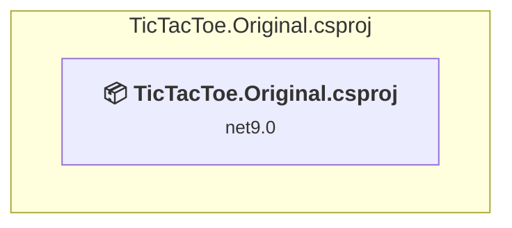

### API Compatibility

| Category | Count | Impact |
| :--- | :---: | :--- |
| 🔴 Binary Incompatible | 0 | High - Require code changes |
| 🟡 Source Incompatible | 0 | Medium - Needs re-compilation and potential conflicting API error fixing |
| 🔵 Behavioral change | 0 | Low - Behavioral changes that may require testing at runtime |
| ✅ Compatible | 397 |  |
| ***Total APIs Analyzed*** | ***397*** |  |

<a id="02_tictactoeb_testableteststictactoetestabletestscsproj"></a>
### 02_TicTacToe\B_Testable.Tests\TicTacToe.Testable.Tests.csproj

#### Project Info

- **Current Target Framework:** net9.0
- **Proposed Target Framework:** net10.0
- **SDK-style**: True
- **Project Kind:** DotNetCoreApp
- **Dependencies**: 1
- **Dependants**: 0
- **Number of Files**: 4
- **Number of Files with Incidents**: 1
- **Lines of Code**: 146
- **Estimated LOC to modify**: 0+ (at least 0,0% of the project)

#### Dependency Graph

Legend:
📦 SDK-style project
⚙️ Classic project

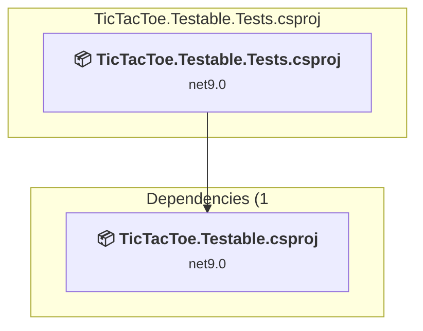

### API Compatibility

| Category | Count | Impact |
| :--- | :---: | :--- |
| 🔴 Binary Incompatible | 0 | High - Require code changes |
| 🟡 Source Incompatible | 0 | Medium - Needs re-compilation and potential conflicting API error fixing |
| 🔵 Behavioral change | 0 | Low - Behavioral changes that may require testing at runtime |
| ✅ Compatible | 127 |  |
| ***Total APIs Analyzed*** | ***127*** |  |

<a id="02_tictactoeb_testabletictactoetestablecsproj"></a>
### 02_TicTacToe\B_Testable\TicTacToe.Testable.csproj

#### Project Info

- **Current Target Framework:** net9.0
- **Proposed Target Framework:** net10.0
- **SDK-style**: True
- **Project Kind:** DotNetCoreApp
- **Dependencies**: 0
- **Dependants**: 1
- **Number of Files**: 5
- **Number of Files with Incidents**: 1
- **Lines of Code**: 415
- **Estimated LOC to modify**: 0+ (at least 0,0% of the project)

#### Dependency Graph

Legend:
📦 SDK-style project
⚙️ Classic project

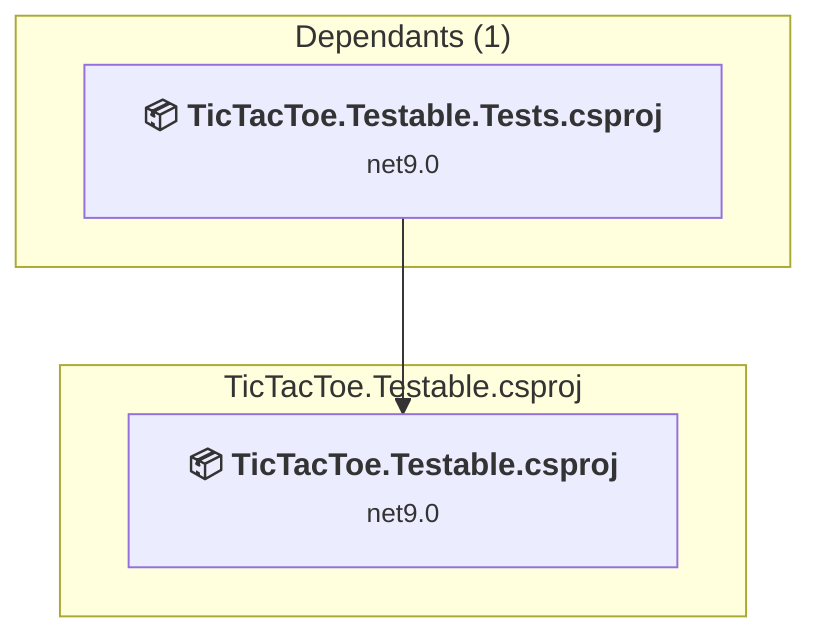

### API Compatibility

| Category | Count | Impact |
| :--- | :---: | :--- |
| 🔴 Binary Incompatible | 0 | High - Require code changes |
| 🟡 Source Incompatible | 0 | Medium - Needs re-compilation and potential conflicting API error fixing |
| 🔵 Behavioral change | 0 | Low - Behavioral changes that may require testing at runtime |
| ✅ Compatible | 561 |  |
| ***Total APIs Analyzed*** | ***561*** |  |

<a id="02_tictactoed_finalteststictactoefinaltestscsproj"></a>
### 02_TicTacToe\D_Final.Tests\TicTacToe.Final.Tests.csproj

#### Project Info

- **Current Target Framework:** net9.0
- **Proposed Target Framework:** net10.0
- **SDK-style**: True
- **Project Kind:** DotNetCoreApp
- **Dependencies**: 1
- **Dependants**: 0
- **Number of Files**: 5
- **Number of Files with Incidents**: 1
- **Lines of Code**: 136
- **Estimated LOC to modify**: 0+ (at least 0,0% of the project)

#### Dependency Graph

Legend:
📦 SDK-style project
⚙️ Classic project


### API Compatibility

| Category | Count | Impact |
| :--- | :---: | :--- |
| 🔴 Binary Incompatible | 0 | High - Require code changes |
| 🟡 Source Incompatible | 0 | Medium - Needs re-compilation and potential conflicting API error fixing |
| 🔵 Behavioral change | 0 | Low - Behavioral changes that may require testing at runtime |
| ✅ Compatible | 131 |  |
| ***Total APIs Analyzed*** | ***131*** |  |

<a id="02_tictactoed_finaltictactoefinalcsproj"></a>
### 02_TicTacToe\D_Final\TicTacToe.Final.csproj

#### Project Info

- **Current Target Framework:** net9.0
- **Proposed Target Framework:** net10.0
- **SDK-style**: True
- **Project Kind:** DotNetCoreApp
- **Dependencies**: 0
- **Dependants**: 1
- **Number of Files**: 6
- **Number of Files with Incidents**: 1
- **Lines of Code**: 198
- **Estimated LOC to modify**: 0+ (at least 0,0% of the project)

#### Dependency Graph

Legend:
📦 SDK-style project
⚙️ Classic project

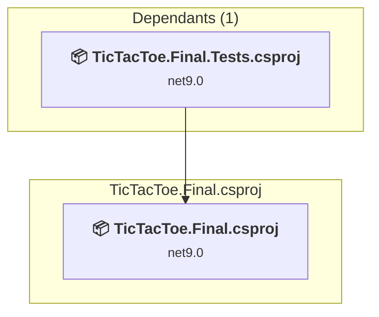

### API Compatibility

| Category | Count | Impact |
| :--- | :---: | :--- |
| 🔴 Binary Incompatible | 0 | High - Require code changes |
| 🟡 Source Incompatible | 0 | Medium - Needs re-compilation and potential conflicting API error fixing |
| 🔵 Behavioral change | 0 | Low - Behavioral changes that may require testing at runtime |
| ✅ Compatible | 238 |  |
| ***Total APIs Analyzed*** | ***238*** |  |

<a id="03_telefona_originalteststelefonoriginaltestscsproj"></a>
### 03_Telefon\A_Original.Tests\Telefon.Original.Tests.csproj

#### Project Info

- **Current Target Framework:** net9.0
- **Proposed Target Framework:** net10.0
- **SDK-style**: True
- **Project Kind:** DotNetCoreApp
- **Dependencies**: 1
- **Dependants**: 0
- **Number of Files**: 3
- **Number of Files with Incidents**: 1
- **Lines of Code**: 154
- **Estimated LOC to modify**: 0+ (at least 0,0% of the project)

#### Dependency Graph

Legend:
📦 SDK-style project
⚙️ Classic project

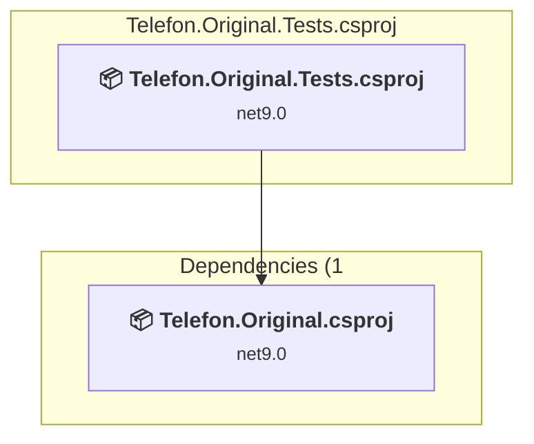

### API Compatibility

| Category | Count | Impact |
| :--- | :---: | :--- |
| 🔴 Binary Incompatible | 0 | High - Require code changes |
| 🟡 Source Incompatible | 0 | Medium - Needs re-compilation and potential conflicting API error fixing |
| 🔵 Behavioral change | 0 | Low - Behavioral changes that may require testing at runtime |
| ✅ Compatible | 149 |  |
| ***Total APIs Analyzed*** | ***149*** |  |

<a id="03_telefona_originaltelefonoriginalcsproj"></a>
### 03_Telefon\A_Original\Telefon.Original.csproj

#### Project Info

- **Current Target Framework:** net9.0
- **Proposed Target Framework:** net10.0
- **SDK-style**: True
- **Project Kind:** ClassLibrary
- **Dependencies**: 0
- **Dependants**: 1
- **Number of Files**: 2
- **Number of Files with Incidents**: 1
- **Lines of Code**: 103
- **Estimated LOC to modify**: 0+ (at least 0,0% of the project)

#### Dependency Graph

Legend:
📦 SDK-style project
⚙️ Classic project


### API Compatibility

| Category | Count | Impact |
| :--- | :---: | :--- |
| 🔴 Binary Incompatible | 0 | High - Require code changes |
| 🟡 Source Incompatible | 0 | Medium - Needs re-compilation and potential conflicting API error fixing |
| 🔵 Behavioral change | 0 | Low - Behavioral changes that may require testing at runtime |
| ✅ Compatible | 133 |  |
| ***Total APIs Analyzed*** | ***133*** |  |

<a id="03_telefonc_refactoredteststelefonrefactoredtestscsproj"></a>
### 03_Telefon\C_Refactored.Tests\Telefon.Refactored.Tests.csproj

#### Project Info

- **Current Target Framework:** net9.0
- **Proposed Target Framework:** net10.0
- **SDK-style**: True
- **Project Kind:** DotNetCoreApp
- **Dependencies**: 1
- **Dependants**: 0
- **Number of Files**: 3
- **Number of Files with Incidents**: 1
- **Lines of Code**: 155
- **Estimated LOC to modify**: 0+ (at least 0,0% of the project)

#### Dependency Graph

Legend:
📦 SDK-style project
⚙️ Classic project

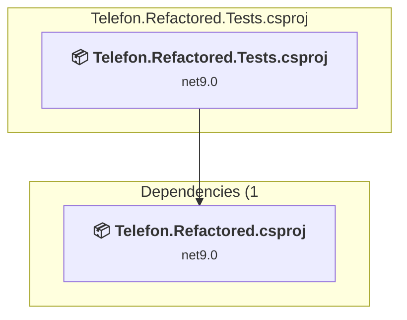

### API Compatibility

| Category | Count | Impact |
| :--- | :---: | :--- |
| 🔴 Binary Incompatible | 0 | High - Require code changes |
| 🟡 Source Incompatible | 0 | Medium - Needs re-compilation and potential conflicting API error fixing |
| 🔵 Behavioral change | 0 | Low - Behavioral changes that may require testing at runtime |
| ✅ Compatible | 139 |  |
| ***Total APIs Analyzed*** | ***139*** |  |

<a id="03_telefonc_refactoredtelefonrefactoredcsproj"></a>
### 03_Telefon\C_Refactored\Telefon.Refactored.csproj

#### Project Info

- **Current Target Framework:** net9.0
- **Proposed Target Framework:** net10.0
- **SDK-style**: True
- **Project Kind:** ClassLibrary
- **Dependencies**: 0
- **Dependants**: 1
- **Number of Files**: 5
- **Number of Files with Incidents**: 1
- **Lines of Code**: 158
- **Estimated LOC to modify**: 0+ (at least 0,0% of the project)

#### Dependency Graph

Legend:
📦 SDK-style project
⚙️ Classic project

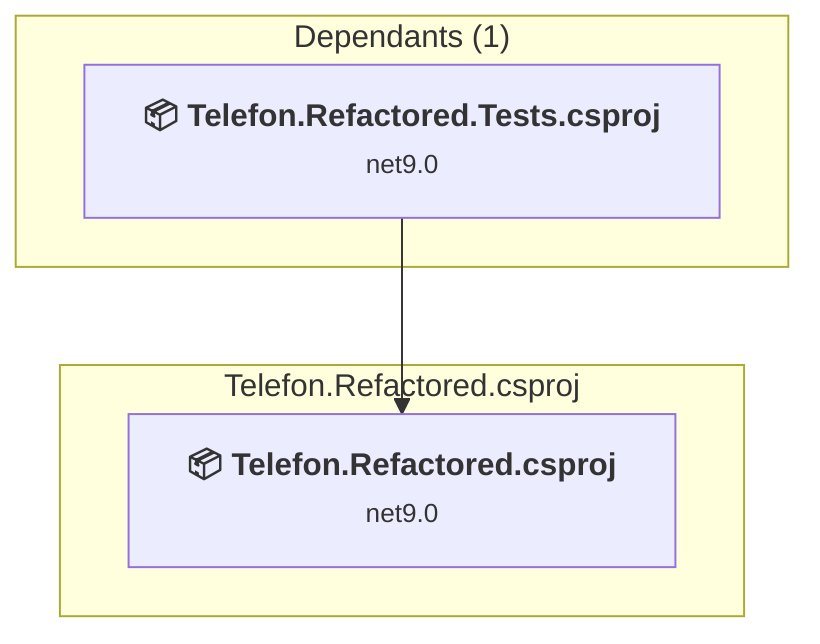

### API Compatibility

| Category | Count | Impact |
| :--- | :---: | :--- |
| 🔴 Binary Incompatible | 0 | High - Require code changes |
| 🟡 Source Incompatible | 0 | Medium - Needs re-compilation and potential conflicting API error fixing |
| 🔵 Behavioral change | 0 | Low - Behavioral changes that may require testing at runtime |
| ✅ Compatible | 184 |  |
| ***Total APIs Analyzed*** | ***184*** |  |

<a id="06_gildedrosea_originaltestsgildedrosekataoriginaltestscsproj"></a>
### 06_GildedRose\A_Original.Tests\GildedRoseKata.Original.Tests.csproj

#### Project Info

- **Current Target Framework:** net9.0
- **Proposed Target Framework:** net10.0
- **SDK-style**: True
- **Project Kind:** DotNetCoreApp
- **Dependencies**: 1
- **Dependants**: 0
- **Number of Files**: 3
- **Number of Files with Incidents**: 1
- **Lines of Code**: 113
- **Estimated LOC to modify**: 0+ (at least 0,0% of the project)

#### Dependency Graph

Legend:
📦 SDK-style project
⚙️ Classic project

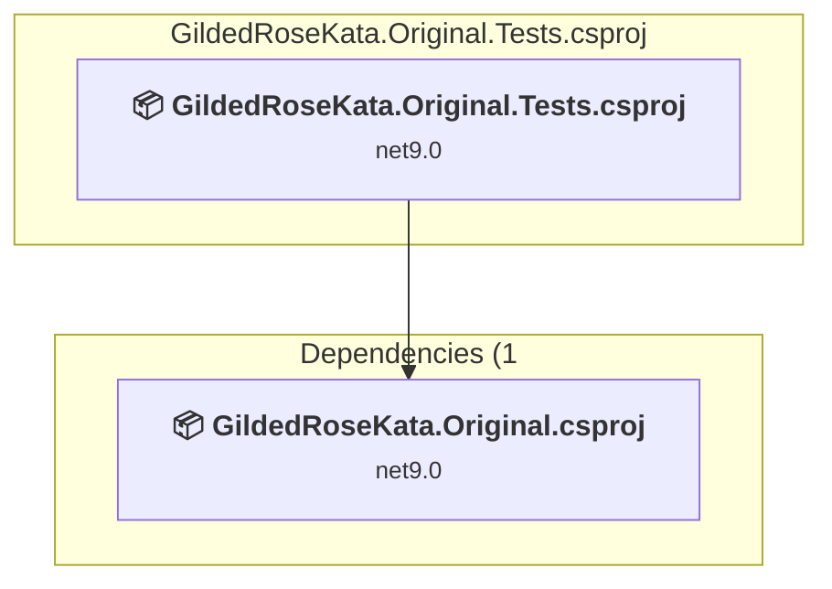

### API Compatibility

| Category | Count | Impact |
| :--- | :---: | :--- |
| 🔴 Binary Incompatible | 0 | High - Require code changes |
| 🟡 Source Incompatible | 0 | Medium - Needs re-compilation and potential conflicting API error fixing |
| 🔵 Behavioral change | 0 | Low - Behavioral changes that may require testing at runtime |
| ✅ Compatible | 169 |  |
| ***Total APIs Analyzed*** | ***169*** |  |

<a id="06_gildedrosea_originalgildedrosekataoriginalcsproj"></a>
### 06_GildedRose\A_Original\GildedRoseKata.Original.csproj

#### Project Info

- **Current Target Framework:** net9.0
- **Proposed Target Framework:** net10.0
- **SDK-style**: True
- **Project Kind:** DotNetCoreApp
- **Dependencies**: 0
- **Dependants**: 1
- **Number of Files**: 3
- **Number of Files with Incidents**: 1
- **Lines of Code**: 154
- **Estimated LOC to modify**: 0+ (at least 0,0% of the project)

#### Dependency Graph

Legend:
📦 SDK-style project
⚙️ Classic project

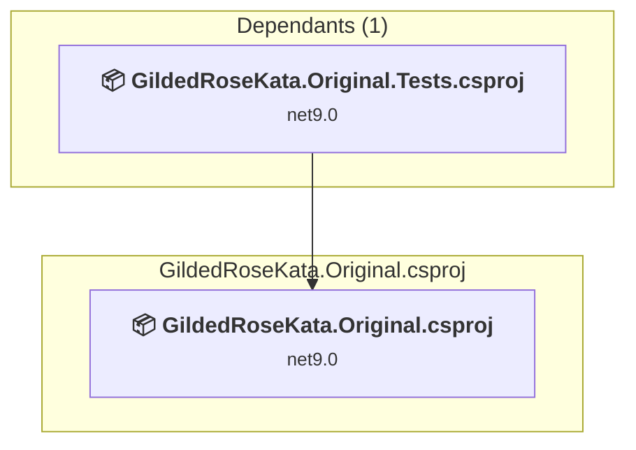

### API Compatibility

| Category | Count | Impact |
| :--- | :---: | :--- |
| 🔴 Binary Incompatible | 0 | High - Require code changes |
| 🟡 Source Incompatible | 0 | Medium - Needs re-compilation and potential conflicting API error fixing |
| 🔵 Behavioral change | 0 | Low - Behavioral changes that may require testing at runtime |
| ✅ Compatible | 201 |  |
| ***Total APIs Analyzed*** | ***201*** |  |

<a id="07_kniffelkniffeloriginaltestskniffeloriginaltestscsproj"></a>
### 07_Kniffel\Kniffel.Original.Tests\Kniffel.Original.Tests.csproj

#### Project Info

- **Current Target Framework:** net9.0
- **Proposed Target Framework:** net10.0
- **SDK-style**: True
- **Project Kind:** DotNetCoreApp
- **Dependencies**: 1
- **Dependants**: 0
- **Number of Files**: 3
- **Number of Files with Incidents**: 1
- **Lines of Code**: 129
- **Estimated LOC to modify**: 0+ (at least 0,0% of the project)

#### Dependency Graph

Legend:
📦 SDK-style project
⚙️ Classic project

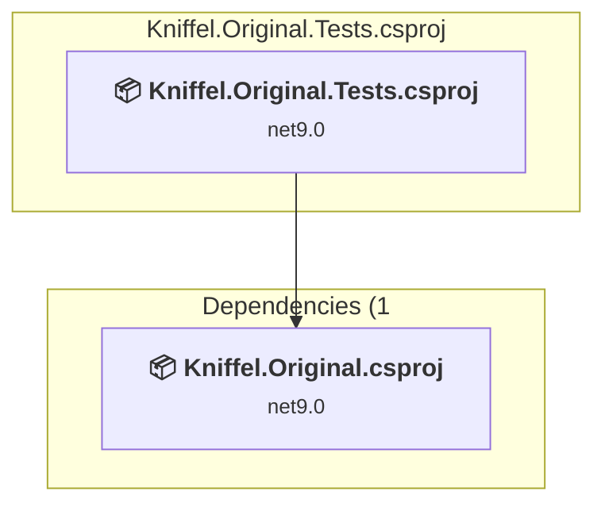

### API Compatibility

| Category | Count | Impact |
| :--- | :---: | :--- |
| 🔴 Binary Incompatible | 0 | High - Require code changes |
| 🟡 Source Incompatible | 0 | Medium - Needs re-compilation and potential conflicting API error fixing |
| 🔵 Behavioral change | 0 | Low - Behavioral changes that may require testing at runtime |
| ✅ Compatible | 319 |  |
| ***Total APIs Analyzed*** | ***319*** |  |

<a id="07_kniffelkniffeloriginalkniffeloriginalcsproj"></a>
### 07_Kniffel\Kniffel.Original\Kniffel.Original.csproj

#### Project Info

- **Current Target Framework:** net9.0
- **Proposed Target Framework:** net10.0
- **SDK-style**: True
- **Project Kind:** DotNetCoreApp
- **Dependencies**: 0
- **Dependants**: 1
- **Number of Files**: 2
- **Number of Files with Incidents**: 1
- **Lines of Code**: 262
- **Estimated LOC to modify**: 0+ (at least 0,0% of the project)

#### Dependency Graph

Legend:
📦 SDK-style project
⚙️ Classic project

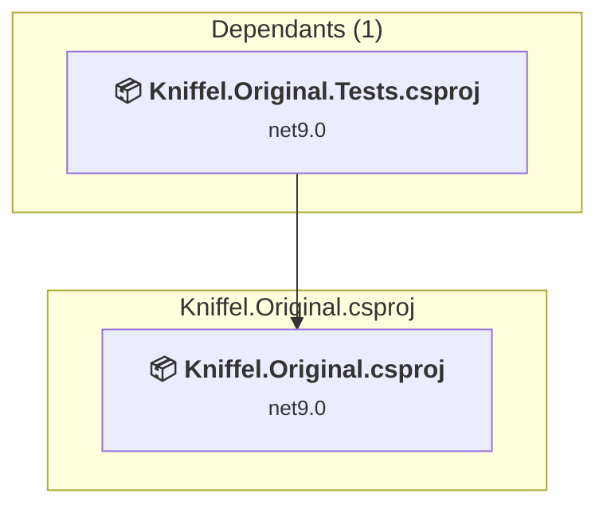

### API Compatibility

| Category | Count | Impact |
| :--- | :---: | :--- |
| 🔴 Binary Incompatible | 0 | High - Require code changes |
| 🟡 Source Incompatible | 0 | Medium - Needs re-compilation and potential conflicting API error fixing |
| 🔵 Behavioral change | 0 | Low - Behavioral changes that may require testing at runtime |
| ✅ Compatible | 132 |  |
| ***Total APIs Analyzed*** | ***132*** |  |

<a id="07_kniffelkniffelrefactoredkniffelrefactoredcsproj"></a>
### 07_Kniffel\Kniffel.Refactored\Kniffel.Refactored.csproj

#### Project Info

- **Current Target Framework:** net9.0
- **Proposed Target Framework:** net10.0
- **SDK-style**: True
- **Project Kind:** DotNetCoreApp
- **Dependencies**: 0
- **Dependants**: 0
- **Number of Files**: 15
- **Number of Files with Incidents**: 1
- **Lines of Code**: 431
- **Estimated LOC to modify**: 0+ (at least 0,0% of the project)

#### Dependency Graph

Legend:
📦 SDK-style project
⚙️ Classic project

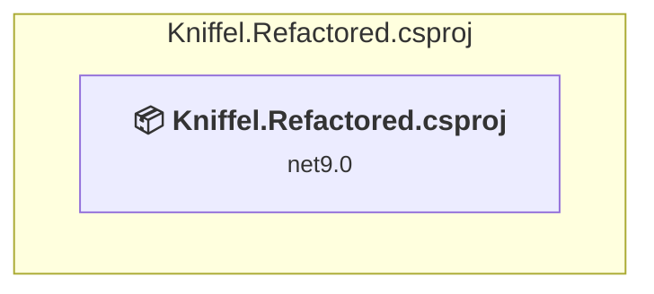

### API Compatibility

| Category | Count | Impact |
| :--- | :---: | :--- |
| 🔴 Binary Incompatible | 0 | High - Require code changes |
| 🟡 Source Incompatible | 0 | Medium - Needs re-compilation and potential conflicting API error fixing |
| 🔵 Behavioral change | 0 | Low - Behavioral changes that may require testing at runtime |
| ✅ Compatible | 356 |  |
| ***Total APIs Analyzed*** | ***356*** |  |

<a id="async1breakfastasync1breakfastcsproj"></a>
### Async1.Breakfast\Async1.Breakfast.csproj

#### Project Info

- **Current Target Framework:** net9.0
- **Proposed Target Framework:** net10.0
- **SDK-style**: True
- **Project Kind:** DotNetCoreApp
- **Dependencies**: 0
- **Dependants**: 0
- **Number of Files**: 6
- **Number of Files with Incidents**: 1
- **Lines of Code**: 213
- **Estimated LOC to modify**: 0+ (at least 0,0% of the project)

#### Dependency Graph

Legend:
📦 SDK-style project
⚙️ Classic project

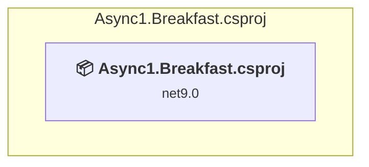

### API Compatibility

| Category | Count | Impact |
| :--- | :---: | :--- |
| 🔴 Binary Incompatible | 0 | High - Require code changes |
| 🟡 Source Incompatible | 0 | Medium - Needs re-compilation and potential conflicting API error fixing |
| 🔵 Behavioral change | 0 | Low - Behavioral changes that may require testing at runtime |
| ✅ Compatible | 218 |  |
| ***Total APIs Analyzed*** | ***218*** |  |

<a id="chargerfinaltestschargerfinaltestscsproj"></a>
### Charger.Final.Tests\Charger.Final.Tests.csproj

#### Project Info

- **Current Target Framework:** net9.0
- **Proposed Target Framework:** net10.0
- **SDK-style**: True
- **Project Kind:** DotNetCoreApp
- **Dependencies**: 1
- **Dependants**: 0
- **Number of Files**: 3
- **Number of Files with Incidents**: 1
- **Lines of Code**: 25
- **Estimated LOC to modify**: 0+ (at least 0,0% of the project)

#### Dependency Graph

Legend:
📦 SDK-style project
⚙️ Classic project

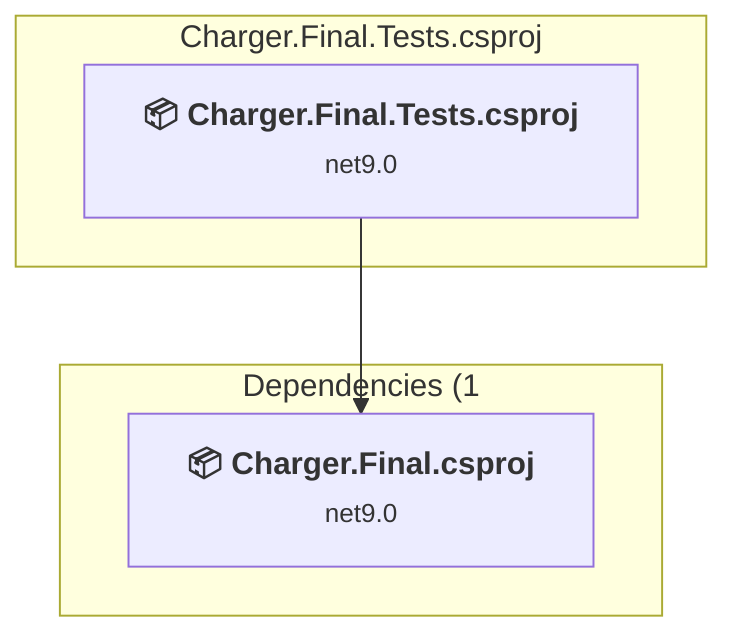

### API Compatibility

| Category | Count | Impact |
| :--- | :---: | :--- |
| 🔴 Binary Incompatible | 0 | High - Require code changes |
| 🟡 Source Incompatible | 0 | Medium - Needs re-compilation and potential conflicting API error fixing |
| 🔵 Behavioral change | 0 | Low - Behavioral changes that may require testing at runtime |
| ✅ Compatible | 19 |  |
| ***Total APIs Analyzed*** | ***19*** |  |

<a id="chargerfinalchargerfinalcsproj"></a>
### Charger.Final\Charger.Final.csproj

#### Project Info

- **Current Target Framework:** net9.0
- **Proposed Target Framework:** net10.0
- **SDK-style**: True
- **Project Kind:** DotNetCoreApp
- **Dependencies**: 0
- **Dependants**: 1
- **Number of Files**: 5
- **Number of Files with Incidents**: 1
- **Lines of Code**: 76
- **Estimated LOC to modify**: 0+ (at least 0,0% of the project)

#### Dependency Graph

Legend:
📦 SDK-style project
⚙️ Classic project

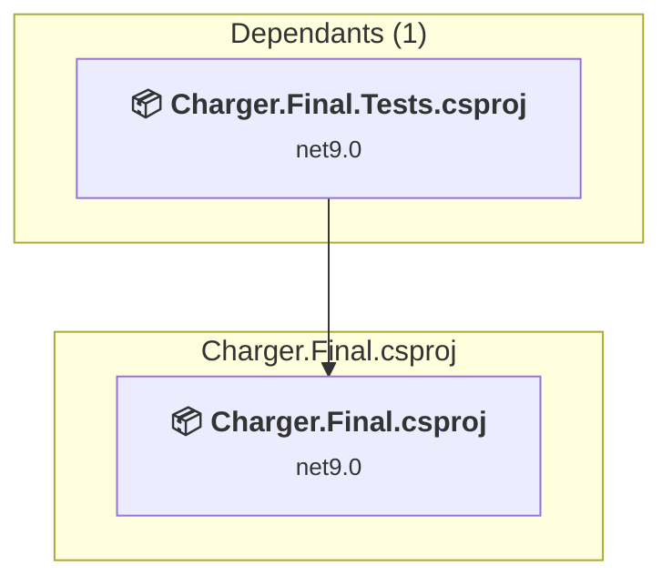

### API Compatibility

| Category | Count | Impact |
| :--- | :---: | :--- |
| 🔴 Binary Incompatible | 0 | High - Require code changes |
| 🟡 Source Incompatible | 0 | Medium - Needs re-compilation and potential conflicting API error fixing |
| 🔵 Behavioral change | 0 | Low - Behavioral changes that may require testing at runtime |
| ✅ Compatible | 25 |  |
| ***Total APIs Analyzed*** | ***25*** |  |

<a id="chargeroriginalchargeroriginalcsproj"></a>
### Charger.Original\Charger.Original.csproj

#### Project Info

- **Current Target Framework:** net9.0
- **Proposed Target Framework:** net10.0
- **SDK-style**: True
- **Project Kind:** DotNetCoreApp
- **Dependencies**: 0
- **Dependants**: 0
- **Number of Files**: 4
- **Number of Files with Incidents**: 1
- **Lines of Code**: 54
- **Estimated LOC to modify**: 0+ (at least 0,0% of the project)

#### Dependency Graph

Legend:
📦 SDK-style project
⚙️ Classic project

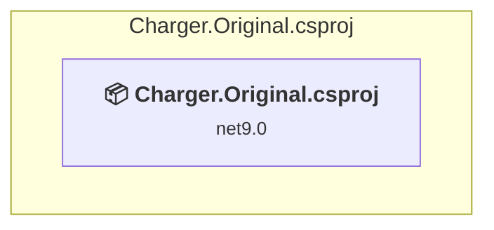

### API Compatibility

| Category | Count | Impact |
| :--- | :---: | :--- |
| 🔴 Binary Incompatible | 0 | High - Require code changes |
| 🟡 Source Incompatible | 0 | Medium - Needs re-compilation and potential conflicting API error fixing |
| 🔵 Behavioral change | 0 | Low - Behavioral changes that may require testing at runtime |
| ✅ Compatible | 18 |  |
| ***Total APIs Analyzed*** | ***18*** |  |

<a id="datenbankdatenbankcsproj"></a>
### Datenbank\Datenbank.csproj

#### Project Info

- **Current Target Framework:** net9.0
- **Proposed Target Framework:** net10.0
- **SDK-style**: True
- **Project Kind:** DotNetCoreApp
- **Dependencies**: 0
- **Dependants**: 0
- **Number of Files**: 3
- **Number of Files with Incidents**: 1
- **Lines of Code**: 69
- **Estimated LOC to modify**: 0+ (at least 0,0% of the project)

#### Dependency Graph

Legend:
📦 SDK-style project
⚙️ Classic project

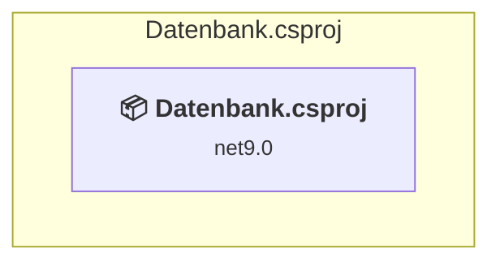

### API Compatibility

| Category | Count | Impact |
| :--- | :---: | :--- |
| 🔴 Binary Incompatible | 0 | High - Require code changes |
| 🟡 Source Incompatible | 0 | Medium - Needs re-compilation and potential conflicting API error fixing |
| 🔵 Behavioral change | 0 | Low - Behavioral changes that may require testing at runtime |
| ✅ Compatible | 30 |  |
| ***Total APIs Analyzed*** | ***30*** |  |

<a id="dependencyinversiondependencyinversioncsproj"></a>
### DependencyInversion\DependencyInversion.csproj

#### Project Info

- **Current Target Framework:** net9.0
- **Proposed Target Framework:** net10.0
- **SDK-style**: True
- **Project Kind:** DotNetCoreApp
- **Dependencies**: 0
- **Dependants**: 0
- **Number of Files**: 4
- **Number of Files with Incidents**: 1
- **Lines of Code**: 51
- **Estimated LOC to modify**: 0+ (at least 0,0% of the project)

#### Dependency Graph

Legend:
📦 SDK-style project
⚙️ Classic project

```mermaid
flowchart TB
    subgraph current["DependencyInversion.csproj"]
        MAIN["<b>📦&nbsp;DependencyInversion.csproj</b><br/><small>net9.0</small>"]
        click MAIN "#dependencyinversiondependencyinversioncsproj"
    end

```

### API Compatibility

| Category | Count | Impact |
| :--- | :---: | :--- |
| 🔴 Binary Incompatible | 0 | High - Require code changes |
| 🟡 Source Incompatible | 0 | Medium - Needs re-compilation and potential conflicting API error fixing |
| 🔵 Behavioral change | 0 | Low - Behavioral changes that may require testing at runtime |
| ✅ Compatible | 18 |  |
| ***Total APIs Analyzed*** | ***18*** |  |

<a id="dokumentationdokumentationcsproj"></a>
### Dokumentation\Dokumentation.csproj

#### Project Info

- **Current Target Framework:** net9.0
- **Proposed Target Framework:** net10.0
- **SDK-style**: True
- **Project Kind:** DotNetCoreApp
- **Dependencies**: 0
- **Dependants**: 0
- **Number of Files**: 1
- **Number of Files with Incidents**: 1
- **Lines of Code**: 17
- **Estimated LOC to modify**: 0+ (at least 0,0% of the project)

#### Dependency Graph

Legend:
📦 SDK-style project
⚙️ Classic project

```mermaid
flowchart TB
    subgraph current["Dokumentation.csproj"]
        MAIN["<b>📦&nbsp;Dokumentation.csproj</b><br/><small>net9.0</small>"]
        click MAIN "#dokumentationdokumentationcsproj"
    end

```

### API Compatibility

| Category | Count | Impact |
| :--- | :---: | :--- |
| 🔴 Binary Incompatible | 0 | High - Require code changes |
| 🟡 Source Incompatible | 0 | Medium - Needs re-compilation and potential conflicting API error fixing |
| 🔵 Behavioral change | 0 | Low - Behavioral changes that may require testing at runtime |
| ✅ Compatible | 4 |  |
| ***Total APIs Analyzed*** | ***4*** |  |

<a id="gildedrosekatatestdriventestsgildedrosekatatestdriventestscsproj"></a>
### GildedRoseKata.TestDriven.Tests\GildedRoseKata.TestDriven.Tests.csproj

#### Project Info

- **Current Target Framework:** net9.0
- **Proposed Target Framework:** net10.0
- **SDK-style**: True
- **Project Kind:** DotNetCoreApp
- **Dependencies**: 1
- **Dependants**: 0
- **Number of Files**: 3
- **Number of Files with Incidents**: 1
- **Lines of Code**: 155
- **Estimated LOC to modify**: 0+ (at least 0,0% of the project)

#### Dependency Graph

Legend:
📦 SDK-style project
⚙️ Classic project

```mermaid
flowchart TB
    subgraph current["GildedRoseKata.TestDriven.Tests.csproj"]
        MAIN["<b>📦&nbsp;GildedRoseKata.TestDriven.Tests.csproj</b><br/><small>net9.0</small>"]
        click MAIN "#gildedrosekatatestdriventestsgildedrosekatatestdriventestscsproj"
    end
    subgraph downstream["Dependencies (1"]
        P22["<b>📦&nbsp;GildedRoseKata.TestDriven.csproj</b><br/><small>net9.0</small>"]
        click P22 "#gildedrosekatatestdrivengildedrosekatatestdrivencsproj"
    end
    MAIN --> P22

```

### API Compatibility

| Category | Count | Impact |
| :--- | :---: | :--- |
| 🔴 Binary Incompatible | 0 | High - Require code changes |
| 🟡 Source Incompatible | 0 | Medium - Needs re-compilation and potential conflicting API error fixing |
| 🔵 Behavioral change | 0 | Low - Behavioral changes that may require testing at runtime |
| ✅ Compatible | 1 |  |
| ***Total APIs Analyzed*** | ***1*** |  |

<a id="gildedrosekatatestdrivengildedrosekatatestdrivencsproj"></a>
### GildedRoseKata.TestDriven\GildedRoseKata.TestDriven.csproj

#### Project Info

- **Current Target Framework:** net9.0
- **Proposed Target Framework:** net10.0
- **SDK-style**: True
- **Project Kind:** DotNetCoreApp
- **Dependencies**: 0
- **Dependants**: 1
- **Number of Files**: 1
- **Number of Files with Incidents**: 1
- **Lines of Code**: 10
- **Estimated LOC to modify**: 0+ (at least 0,0% of the project)

#### Dependency Graph

Legend:
📦 SDK-style project
⚙️ Classic project

```mermaid
flowchart TB
    subgraph upstream["Dependants (1)"]
        P23["<b>📦&nbsp;GildedRoseKata.TestDriven.Tests.csproj</b><br/><small>net9.0</small>"]
        click P23 "#gildedrosekatatestdriventestsgildedrosekatatestdriventestscsproj"
    end
    subgraph current["GildedRoseKata.TestDriven.csproj"]
        MAIN["<b>📦&nbsp;GildedRoseKata.TestDriven.csproj</b><br/><small>net9.0</small>"]
        click MAIN "#gildedrosekatatestdrivengildedrosekatatestdrivencsproj"
    end
    P23 --> MAIN

```

### API Compatibility

| Category | Count | Impact |
| :--- | :---: | :--- |
| 🔴 Binary Incompatible | 0 | High - Require code changes |
| 🟡 Source Incompatible | 0 | Medium - Needs re-compilation and potential conflicting API error fixing |
| 🔵 Behavioral change | 0 | Low - Behavioral changes that may require testing at runtime |
| ✅ Compatible | 4 |  |
| ***Total APIs Analyzed*** | ***4*** |  |

<a id="ibanvalidationtestsibanvalidationtestscsproj"></a>
### IbanValidation.Tests\IbanValidation.Tests.csproj

#### Project Info

- **Current Target Framework:** net9.0
- **Proposed Target Framework:** net10.0
- **SDK-style**: True
- **Project Kind:** DotNetCoreApp
- **Dependencies**: 1
- **Dependants**: 0
- **Number of Files**: 3
- **Number of Files with Incidents**: 1
- **Lines of Code**: 53
- **Estimated LOC to modify**: 0+ (at least 0,0% of the project)

#### Dependency Graph

Legend:
📦 SDK-style project
⚙️ Classic project

```mermaid
flowchart TB
    subgraph current["IbanValidation.Tests.csproj"]
        MAIN["<b>📦&nbsp;IbanValidation.Tests.csproj</b><br/><small>net9.0</small>"]
        click MAIN "#ibanvalidationtestsibanvalidationtestscsproj"
    end
    subgraph downstream["Dependencies (1"]
        P30["<b>📦&nbsp;IbanValidation.csproj</b><br/><small>net9.0</small>"]
        click P30 "#ibanvalidationibanvalidationcsproj"
    end
    MAIN --> P30

```

### API Compatibility

| Category | Count | Impact |
| :--- | :---: | :--- |
| 🔴 Binary Incompatible | 0 | High - Require code changes |
| 🟡 Source Incompatible | 0 | Medium - Needs re-compilation and potential conflicting API error fixing |
| 🔵 Behavioral change | 0 | Low - Behavioral changes that may require testing at runtime |
| ✅ Compatible | 64 |  |
| ***Total APIs Analyzed*** | ***64*** |  |

<a id="ibanvalidationibanvalidationcsproj"></a>
### IbanValidation\IbanValidation.csproj

#### Project Info

- **Current Target Framework:** net9.0
- **Proposed Target Framework:** net10.0
- **SDK-style**: True
- **Project Kind:** DotNetCoreApp
- **Dependencies**: 0
- **Dependants**: 1
- **Number of Files**: 2
- **Number of Files with Incidents**: 2
- **Lines of Code**: 61
- **Estimated LOC to modify**: 1+ (at least 1,6% of the project)

#### Dependency Graph

Legend:
📦 SDK-style project
⚙️ Classic project

```mermaid
flowchart TB
    subgraph upstream["Dependants (1)"]
        P31["<b>📦&nbsp;IbanValidation.Tests.csproj</b><br/><small>net9.0</small>"]
        click P31 "#ibanvalidationtestsibanvalidationtestscsproj"
    end
    subgraph current["IbanValidation.csproj"]
        MAIN["<b>📦&nbsp;IbanValidation.csproj</b><br/><small>net9.0</small>"]
        click MAIN "#ibanvalidationibanvalidationcsproj"
    end
    P31 --> MAIN

```

### API Compatibility

| Category | Count | Impact |
| :--- | :---: | :--- |
| 🔴 Binary Incompatible | 0 | High - Require code changes |
| 🟡 Source Incompatible | 1 | Medium - Needs re-compilation and potential conflicting API error fixing |
| 🔵 Behavioral change | 0 | Low - Behavioral changes that may require testing at runtime |
| ✅ Compatible | 34 |  |
| ***Total APIs Analyzed*** | ***35*** |  |

<a id="interfacesegragationinterfacesegregationcsproj"></a>
### InterfaceSegragation\InterfaceSegregation.csproj

#### Project Info

- **Current Target Framework:** net9.0
- **Proposed Target Framework:** net10.0
- **SDK-style**: True
- **Project Kind:** DotNetCoreApp
- **Dependencies**: 0
- **Dependants**: 0
- **Number of Files**: 5
- **Number of Files with Incidents**: 1
- **Lines of Code**: 46
- **Estimated LOC to modify**: 0+ (at least 0,0% of the project)

#### Dependency Graph

Legend:
📦 SDK-style project
⚙️ Classic project

```mermaid
flowchart TB
    subgraph current["InterfaceSegregation.csproj"]
        MAIN["<b>📦&nbsp;InterfaceSegregation.csproj</b><br/><small>net9.0</small>"]
        click MAIN "#interfacesegragationinterfacesegregationcsproj"
    end

```

### API Compatibility

| Category | Count | Impact |
| :--- | :---: | :--- |
| 🔴 Binary Incompatible | 0 | High - Require code changes |
| 🟡 Source Incompatible | 0 | Medium - Needs re-compilation and potential conflicting API error fixing |
| 🔵 Behavioral change | 0 | Low - Behavioral changes that may require testing at runtime |
| ✅ Compatible | 23 |  |
| ***Total APIs Analyzed*** | ***23*** |  |

<a id="liskovtestsliskovtestscsproj"></a>
### Liskov.Tests\Liskov.Tests.csproj

#### Project Info

- **Current Target Framework:** net9.0
- **Proposed Target Framework:** net10.0
- **SDK-style**: True
- **Project Kind:** DotNetCoreApp
- **Dependencies**: 1
- **Dependants**: 0
- **Number of Files**: 3
- **Number of Files with Incidents**: 1
- **Lines of Code**: 26
- **Estimated LOC to modify**: 0+ (at least 0,0% of the project)

#### Dependency Graph

Legend:
📦 SDK-style project
⚙️ Classic project

```mermaid
flowchart TB
    subgraph current["Liskov.Tests.csproj"]
        MAIN["<b>📦&nbsp;Liskov.Tests.csproj</b><br/><small>net9.0</small>"]
        click MAIN "#liskovtestsliskovtestscsproj"
    end
    subgraph downstream["Dependencies (1"]
        P18["<b>📦&nbsp;Liskov.csproj</b><br/><small>net9.0</small>"]
        click P18 "#liskovliskovcsproj"
    end
    MAIN --> P18

```

### API Compatibility

| Category | Count | Impact |
| :--- | :---: | :--- |
| 🔴 Binary Incompatible | 0 | High - Require code changes |
| 🟡 Source Incompatible | 0 | Medium - Needs re-compilation and potential conflicting API error fixing |
| 🔵 Behavioral change | 0 | Low - Behavioral changes that may require testing at runtime |
| ✅ Compatible | 20 |  |
| ***Total APIs Analyzed*** | ***20*** |  |

<a id="liskovliskovcsproj"></a>
### Liskov\Liskov.csproj

#### Project Info

- **Current Target Framework:** net9.0
- **Proposed Target Framework:** net10.0
- **SDK-style**: True
- **Project Kind:** DotNetCoreApp
- **Dependencies**: 0
- **Dependants**: 1
- **Number of Files**: 4
- **Number of Files with Incidents**: 1
- **Lines of Code**: 108
- **Estimated LOC to modify**: 0+ (at least 0,0% of the project)

#### Dependency Graph

Legend:
📦 SDK-style project
⚙️ Classic project

```mermaid
flowchart TB
    subgraph upstream["Dependants (1)"]
        P19["<b>📦&nbsp;Liskov.Tests.csproj</b><br/><small>net9.0</small>"]
        click P19 "#liskovtestsliskovtestscsproj"
    end
    subgraph current["Liskov.csproj"]
        MAIN["<b>📦&nbsp;Liskov.csproj</b><br/><small>net9.0</small>"]
        click MAIN "#liskovliskovcsproj"
    end
    P19 --> MAIN

```

### API Compatibility

| Category | Count | Impact |
| :--- | :---: | :--- |
| 🔴 Binary Incompatible | 0 | High - Require code changes |
| 🟡 Source Incompatible | 0 | Medium - Needs re-compilation and potential conflicting API error fixing |
| 🔵 Behavioral change | 0 | Low - Behavioral changes that may require testing at runtime |
| ✅ Compatible | 90 |  |
| ***Total APIs Analyzed*** | ***90*** |  |

<a id="marsroverkatafinaltestsmarsroverkatafinaltestscsproj"></a>
### MarsroverKata.Final.Tests\MarsroverKata.Final.Tests.csproj

#### Project Info

- **Current Target Framework:** net8.0
- **Proposed Target Framework:** net10.0
- **SDK-style**: True
- **Project Kind:** DotNetCoreApp
- **Dependencies**: 1
- **Dependants**: 0
- **Number of Files**: 3
- **Number of Files with Incidents**: 1
- **Lines of Code**: 100
- **Estimated LOC to modify**: 0+ (at least 0,0% of the project)

#### Dependency Graph

Legend:
📦 SDK-style project
⚙️ Classic project

```mermaid
flowchart TB
    subgraph current["MarsroverKata.Final.Tests.csproj"]
        MAIN["<b>📦&nbsp;MarsroverKata.Final.Tests.csproj</b><br/><small>net8.0</small>"]
        click MAIN "#marsroverkatafinaltestsmarsroverkatafinaltestscsproj"
    end
    subgraph downstream["Dependencies (1"]
        P42["<b>📦&nbsp;MarsroverKata.Final.csproj</b><br/><small>net8.0</small>"]
        click P42 "#marsroverkatafinalmarsroverkatafinalmarsroverkatafinalcsproj"
    end
    MAIN --> P42

```

### API Compatibility

| Category | Count | Impact |
| :--- | :---: | :--- |
| 🔴 Binary Incompatible | 0 | High - Require code changes |
| 🟡 Source Incompatible | 0 | Medium - Needs re-compilation and potential conflicting API error fixing |
| 🔵 Behavioral change | 0 | Low - Behavioral changes that may require testing at runtime |
| ✅ Compatible | 65 |  |
| ***Total APIs Analyzed*** | ***65*** |  |

<a id="marsroverkatafinalmarsroverkatafinalmarsroverkatafinalcsproj"></a>
### MarsroverKata.Final\MarsroverKata.Final\MarsroverKata.Final.csproj

#### Project Info

- **Current Target Framework:** net8.0
- **Proposed Target Framework:** net10.0
- **SDK-style**: True
- **Project Kind:** DotNetCoreApp
- **Dependencies**: 0
- **Dependants**: 1
- **Number of Files**: 3
- **Number of Files with Incidents**: 1
- **Lines of Code**: 131
- **Estimated LOC to modify**: 0+ (at least 0,0% of the project)

#### Dependency Graph

Legend:
📦 SDK-style project
⚙️ Classic project

```mermaid
flowchart TB
    subgraph upstream["Dependants (1)"]
        P43["<b>📦&nbsp;MarsroverKata.Final.Tests.csproj</b><br/><small>net8.0</small>"]
        click P43 "#marsroverkatafinaltestsmarsroverkatafinaltestscsproj"
    end
    subgraph current["MarsroverKata.Final.csproj"]
        MAIN["<b>📦&nbsp;MarsroverKata.Final.csproj</b><br/><small>net8.0</small>"]
        click MAIN "#marsroverkatafinalmarsroverkatafinalmarsroverkatafinalcsproj"
    end
    P43 --> MAIN

```

### API Compatibility

| Category | Count | Impact |
| :--- | :---: | :--- |
| 🔴 Binary Incompatible | 0 | High - Require code changes |
| 🟡 Source Incompatible | 0 | Medium - Needs re-compilation and potential conflicting API error fixing |
| 🔵 Behavioral change | 0 | Low - Behavioral changes that may require testing at runtime |
| ✅ Compatible | 94 |  |
| ***Total APIs Analyzed*** | ***94*** |  |

<a id="marsroverkatatestsmarsroverkatatestscsproj"></a>
### MarsRoverKata.Tests\MarsRoverKata.Tests.csproj

#### Project Info

- **Current Target Framework:** net9.0
- **Proposed Target Framework:** net10.0
- **SDK-style**: True
- **Project Kind:** DotNetCoreApp
- **Dependencies**: 1
- **Dependants**: 0
- **Number of Files**: 7
- **Number of Files with Incidents**: 1
- **Lines of Code**: 279
- **Estimated LOC to modify**: 0+ (at least 0,0% of the project)

#### Dependency Graph

Legend:
📦 SDK-style project
⚙️ Classic project

```mermaid
flowchart TB
    subgraph current["MarsRoverKata.Tests.csproj"]
        MAIN["<b>📦&nbsp;MarsRoverKata.Tests.csproj</b><br/><small>net9.0</small>"]
        click MAIN "#marsroverkatatestsmarsroverkatatestscsproj"
    end
    subgraph downstream["Dependencies (1"]
        P24["<b>📦&nbsp;MarsRoverKata.csproj</b><br/><small>net9.0</small>"]
        click P24 "#marsroverkatamarsroverkatacsproj"
    end
    MAIN --> P24

```

### API Compatibility

| Category | Count | Impact |
| :--- | :---: | :--- |
| 🔴 Binary Incompatible | 0 | High - Require code changes |
| 🟡 Source Incompatible | 0 | Medium - Needs re-compilation and potential conflicting API error fixing |
| 🔵 Behavioral change | 0 | Low - Behavioral changes that may require testing at runtime |
| ✅ Compatible | 119 |  |
| ***Total APIs Analyzed*** | ***119*** |  |

<a id="marsroverkatamarsroverkatacsproj"></a>
### MarsRoverKata\MarsRoverKata.csproj

#### Project Info

- **Current Target Framework:** net9.0
- **Proposed Target Framework:** net10.0
- **SDK-style**: True
- **Project Kind:** DotNetCoreApp
- **Dependencies**: 0
- **Dependants**: 1
- **Number of Files**: 10
- **Number of Files with Incidents**: 1
- **Lines of Code**: 275
- **Estimated LOC to modify**: 0+ (at least 0,0% of the project)

#### Dependency Graph

Legend:
📦 SDK-style project
⚙️ Classic project

```mermaid
flowchart TB
    subgraph upstream["Dependants (1)"]
        P25["<b>📦&nbsp;MarsRoverKata.Tests.csproj</b><br/><small>net9.0</small>"]
        click P25 "#marsroverkatatestsmarsroverkatatestscsproj"
    end
    subgraph current["MarsRoverKata.csproj"]
        MAIN["<b>📦&nbsp;MarsRoverKata.csproj</b><br/><small>net9.0</small>"]
        click MAIN "#marsroverkatamarsroverkatacsproj"
    end
    P25 --> MAIN

```

### API Compatibility

| Category | Count | Impact |
| :--- | :---: | :--- |
| 🔴 Binary Incompatible | 0 | High - Require code changes |
| 🟡 Source Incompatible | 0 | Medium - Needs re-compilation and potential conflicting API error fixing |
| 🔵 Behavioral change | 0 | Low - Behavioral changes that may require testing at runtime |
| ✅ Compatible | 122 |  |
| ***Total APIs Analyzed*** | ***122*** |  |

<a id="modelcontextprotocolmodelcontextprotocolcsproj"></a>
### ModelContextProtocol\ModelContextProtocol.csproj

#### Project Info

- **Current Target Framework:** net9.0
- **Proposed Target Framework:** net10.0
- **SDK-style**: True
- **Project Kind:** DotNetCoreApp
- **Dependencies**: 0
- **Dependants**: 0
- **Number of Files**: 3
- **Number of Files with Incidents**: 1
- **Lines of Code**: 10
- **Estimated LOC to modify**: 0+ (at least 0,0% of the project)

#### Dependency Graph

Legend:
📦 SDK-style project
⚙️ Classic project

```mermaid
flowchart TB
    subgraph current["ModelContextProtocol.csproj"]
        MAIN["<b>📦&nbsp;ModelContextProtocol.csproj</b><br/><small>net9.0</small>"]
        click MAIN "#modelcontextprotocolmodelcontextprotocolcsproj"
    end

```

### API Compatibility

| Category | Count | Impact |
| :--- | :---: | :--- |
| 🔴 Binary Incompatible | 0 | High - Require code changes |
| 🟡 Source Incompatible | 0 | Medium - Needs re-compilation and potential conflicting API error fixing |
| 🔵 Behavioral change | 0 | Low - Behavioral changes that may require testing at runtime |
| ✅ Compatible | 4 |  |
| ***Total APIs Analyzed*** | ***4*** |  |

<a id="openapiautomationopenapiautomationcsproj"></a>
### OpenApiAutomation\OpenApiAutomation.csproj

#### Project Info

- **Current Target Framework:** net9.0
- **Proposed Target Framework:** net10.0
- **SDK-style**: True
- **Project Kind:** DotNetCoreApp
- **Dependencies**: 0
- **Dependants**: 0
- **Number of Files**: 1
- **Number of Files with Incidents**: 2
- **Lines of Code**: 150
- **Estimated LOC to modify**: 4+ (at least 2,7% of the project)

#### Dependency Graph

Legend:
📦 SDK-style project
⚙️ Classic project

```mermaid
flowchart TB
    subgraph current["OpenApiAutomation.csproj"]
        MAIN["<b>📦&nbsp;OpenApiAutomation.csproj</b><br/><small>net9.0</small>"]
        click MAIN "#openapiautomationopenapiautomationcsproj"
    end

```

### API Compatibility

| Category | Count | Impact |
| :--- | :---: | :--- |
| 🔴 Binary Incompatible | 0 | High - Require code changes |
| 🟡 Source Incompatible | 0 | Medium - Needs re-compilation and potential conflicting API error fixing |
| 🔵 Behavioral change | 4 | Low - Behavioral changes that may require testing at runtime |
| ✅ Compatible | 133 |  |
| ***Total APIs Analyzed*** | ***137*** |  |

<a id="openclosedfinalopenclosedfinalcsproj"></a>
### OpenClosed.Final\OpenClosed.Final.csproj

#### Project Info

- **Current Target Framework:** net9.0
- **Proposed Target Framework:** net10.0
- **SDK-style**: True
- **Project Kind:** DotNetCoreApp
- **Dependencies**: 0
- **Dependants**: 0
- **Number of Files**: 7
- **Number of Files with Incidents**: 1
- **Lines of Code**: 119
- **Estimated LOC to modify**: 0+ (at least 0,0% of the project)

#### Dependency Graph

Legend:
📦 SDK-style project
⚙️ Classic project

```mermaid
flowchart TB
    subgraph current["OpenClosed.Final.csproj"]
        MAIN["<b>📦&nbsp;OpenClosed.Final.csproj</b><br/><small>net9.0</small>"]
        click MAIN "#openclosedfinalopenclosedfinalcsproj"
    end

```

### API Compatibility

| Category | Count | Impact |
| :--- | :---: | :--- |
| 🔴 Binary Incompatible | 0 | High - Require code changes |
| 🟡 Source Incompatible | 0 | Medium - Needs re-compilation and potential conflicting API error fixing |
| 🔵 Behavioral change | 0 | Low - Behavioral changes that may require testing at runtime |
| ✅ Compatible | 111 |  |
| ***Total APIs Analyzed*** | ***111*** |  |

<a id="openclosedoriginaltestsopenclosedoriginaltestscsproj"></a>
### OpenClosed.Original.Tests\OpenClosed.Original.Tests.csproj

#### Project Info

- **Current Target Framework:** net9.0
- **Proposed Target Framework:** net10.0
- **SDK-style**: True
- **Project Kind:** DotNetCoreApp
- **Dependencies**: 1
- **Dependants**: 0
- **Number of Files**: 3
- **Number of Files with Incidents**: 1
- **Lines of Code**: 36
- **Estimated LOC to modify**: 0+ (at least 0,0% of the project)

#### Dependency Graph

Legend:
📦 SDK-style project
⚙️ Classic project

```mermaid
flowchart TB
    subgraph current["OpenClosed.Original.Tests.csproj"]
        MAIN["<b>📦&nbsp;OpenClosed.Original.Tests.csproj</b><br/><small>net9.0</small>"]
        click MAIN "#openclosedoriginaltestsopenclosedoriginaltestscsproj"
    end
    subgraph downstream["Dependencies (1"]
        P15["<b>📦&nbsp;OpenClosed.Original.csproj</b><br/><small>net9.0</small>"]
        click P15 "#openclosedoriginalopenclosedoriginalcsproj"
    end
    MAIN --> P15

```

### API Compatibility

| Category | Count | Impact |
| :--- | :---: | :--- |
| 🔴 Binary Incompatible | 0 | High - Require code changes |
| 🟡 Source Incompatible | 0 | Medium - Needs re-compilation and potential conflicting API error fixing |
| 🔵 Behavioral change | 0 | Low - Behavioral changes that may require testing at runtime |
| ✅ Compatible | 33 |  |
| ***Total APIs Analyzed*** | ***33*** |  |

<a id="openclosedoriginalopenclosedoriginalcsproj"></a>
### OpenClosed.Original\OpenClosed.Original.csproj

#### Project Info

- **Current Target Framework:** net9.0
- **Proposed Target Framework:** net10.0
- **SDK-style**: True
- **Project Kind:** DotNetCoreApp
- **Dependencies**: 0
- **Dependants**: 1
- **Number of Files**: 2
- **Number of Files with Incidents**: 1
- **Lines of Code**: 34
- **Estimated LOC to modify**: 0+ (at least 0,0% of the project)

#### Dependency Graph

Legend:
📦 SDK-style project
⚙️ Classic project

```mermaid
flowchart TB
    subgraph upstream["Dependants (1)"]
        P16["<b>📦&nbsp;OpenClosed.Original.Tests.csproj</b><br/><small>net9.0</small>"]
        click P16 "#openclosedoriginaltestsopenclosedoriginaltestscsproj"
    end
    subgraph current["OpenClosed.Original.csproj"]
        MAIN["<b>📦&nbsp;OpenClosed.Original.csproj</b><br/><small>net9.0</small>"]
        click MAIN "#openclosedoriginalopenclosedoriginalcsproj"
    end
    P16 --> MAIN

```

### API Compatibility

| Category | Count | Impact |
| :--- | :---: | :--- |
| 🔴 Binary Incompatible | 0 | High - Require code changes |
| 🟡 Source Incompatible | 0 | Medium - Needs re-compilation and potential conflicting API error fixing |
| 🔵 Behavioral change | 0 | Low - Behavioral changes that may require testing at runtime |
| ✅ Compatible | 30 |  |
| ***Total APIs Analyzed*** | ***30*** |  |

<a id="performancetuningperformancetuningcsproj"></a>
### PerformanceTuning\PerformanceTuning.csproj

#### Project Info

- **Current Target Framework:** net9.0
- **Proposed Target Framework:** net10.0
- **SDK-style**: True
- **Project Kind:** DotNetCoreApp
- **Dependencies**: 0
- **Dependants**: 0
- **Number of Files**: 3
- **Number of Files with Incidents**: 1
- **Lines of Code**: 145
- **Estimated LOC to modify**: 0+ (at least 0,0% of the project)

#### Dependency Graph

Legend:
📦 SDK-style project
⚙️ Classic project

```mermaid
flowchart TB
    subgraph current["PerformanceTuning.csproj"]
        MAIN["<b>📦&nbsp;PerformanceTuning.csproj</b><br/><small>net9.0</small>"]
        click MAIN "#performancetuningperformancetuningcsproj"
    end

```

### API Compatibility

| Category | Count | Impact |
| :--- | :---: | :--- |
| 🔴 Binary Incompatible | 0 | High - Require code changes |
| 🟡 Source Incompatible | 0 | Medium - Needs re-compilation and potential conflicting API error fixing |
| 🔵 Behavioral change | 0 | Low - Behavioral changes that may require testing at runtime |
| ✅ Compatible | 85 |  |
| ***Total APIs Analyzed*** | ***85*** |  |

<a id="promptfilespromptfilescsproj"></a>
### PromptFiles\PromptFiles.csproj

#### Project Info

- **Current Target Framework:** net9.0
- **Proposed Target Framework:** net10.0
- **SDK-style**: True
- **Project Kind:** DotNetCoreApp
- **Dependencies**: 0
- **Dependants**: 0
- **Number of Files**: 1
- **Number of Files with Incidents**: 1
- **Lines of Code**: 10
- **Estimated LOC to modify**: 0+ (at least 0,0% of the project)

#### Dependency Graph

Legend:
📦 SDK-style project
⚙️ Classic project

```mermaid
flowchart TB
    subgraph current["PromptFiles.csproj"]
        MAIN["<b>📦&nbsp;PromptFiles.csproj</b><br/><small>net9.0</small>"]
        click MAIN "#promptfilespromptfilescsproj"
    end

```

### API Compatibility

| Category | Count | Impact |
| :--- | :---: | :--- |
| 🔴 Binary Incompatible | 0 | High - Require code changes |
| 🟡 Source Incompatible | 0 | Medium - Needs re-compilation and potential conflicting API error fixing |
| 🔵 Behavioral change | 0 | Low - Behavioral changes that may require testing at runtime |
| ✅ Compatible | 4 |  |
| ***Total APIs Analyzed*** | ***4*** |  |

<a id="repositorycustominstructionsrepositorycustominstructionscsproj"></a>
### RepositoryCustomInstructions\RepositoryCustomInstructions.csproj

#### Project Info

- **Current Target Framework:** net9.0
- **Proposed Target Framework:** net10.0
- **SDK-style**: True
- **Project Kind:** DotNetCoreApp
- **Dependencies**: 0
- **Dependants**: 0
- **Number of Files**: 1
- **Number of Files with Incidents**: 1
- **Lines of Code**: 11
- **Estimated LOC to modify**: 0+ (at least 0,0% of the project)

#### Dependency Graph

Legend:
📦 SDK-style project
⚙️ Classic project

```mermaid
flowchart TB
    subgraph current["RepositoryCustomInstructions.csproj"]
        MAIN["<b>📦&nbsp;RepositoryCustomInstructions.csproj</b><br/><small>net9.0</small>"]
        click MAIN "#repositorycustominstructionsrepositorycustominstructionscsproj"
    end

```

### API Compatibility

| Category | Count | Impact |
| :--- | :---: | :--- |
| 🔴 Binary Incompatible | 0 | High - Require code changes |
| 🟡 Source Incompatible | 0 | Medium - Needs re-compilation and potential conflicting API error fixing |
| 🔵 Behavioral change | 0 | Low - Behavioral changes that may require testing at runtime |
| ✅ Compatible | 6 |  |
| ***Total APIs Analyzed*** | ***6*** |  |

<a id="routenplanerroutenplanercsproj"></a>
### Routenplaner\Routenplaner.csproj

#### Project Info

- **Current Target Framework:** net9.0
- **Proposed Target Framework:** net10.0
- **SDK-style**: True
- **Project Kind:** DotNetCoreApp
- **Dependencies**: 0
- **Dependants**: 1
- **Number of Files**: 7
- **Number of Files with Incidents**: 1
- **Lines of Code**: 90
- **Estimated LOC to modify**: 0+ (at least 0,0% of the project)

#### Dependency Graph

Legend:
📦 SDK-style project
⚙️ Classic project

```mermaid
flowchart TB
    subgraph upstream["Dependants (1)"]
        P39["<b>📦&nbsp;Routenplaner.Tests.csproj</b><br/><small>net9.0</small>"]
        click P39 "#routenplanertestsroutenplanertestscsproj"
    end
    subgraph current["Routenplaner.csproj"]
        MAIN["<b>📦&nbsp;Routenplaner.csproj</b><br/><small>net9.0</small>"]
        click MAIN "#routenplanerroutenplanercsproj"
    end
    P39 --> MAIN

```

### API Compatibility

| Category | Count | Impact |
| :--- | :---: | :--- |
| 🔴 Binary Incompatible | 0 | High - Require code changes |
| 🟡 Source Incompatible | 0 | Medium - Needs re-compilation and potential conflicting API error fixing |
| 🔵 Behavioral change | 0 | Low - Behavioral changes that may require testing at runtime |
| ✅ Compatible | 23 |  |
| ***Total APIs Analyzed*** | ***23*** |  |

<a id="routenplanertestsroutenplanertestscsproj"></a>
### RoutenplanerTests\Routenplaner.Tests.csproj

#### Project Info

- **Current Target Framework:** net9.0
- **Proposed Target Framework:** net10.0
- **SDK-style**: True
- **Project Kind:** DotNetCoreApp
- **Dependencies**: 1
- **Dependants**: 0
- **Number of Files**: 3
- **Number of Files with Incidents**: 1
- **Lines of Code**: 67
- **Estimated LOC to modify**: 0+ (at least 0,0% of the project)

#### Dependency Graph

Legend:
📦 SDK-style project
⚙️ Classic project

```mermaid
flowchart TB
    subgraph current["Routenplaner.Tests.csproj"]
        MAIN["<b>📦&nbsp;Routenplaner.Tests.csproj</b><br/><small>net9.0</small>"]
        click MAIN "#routenplanertestsroutenplanertestscsproj"
    end
    subgraph downstream["Dependencies (1"]
        P38["<b>📦&nbsp;Routenplaner.csproj</b><br/><small>net9.0</small>"]
        click P38 "#routenplanerroutenplanercsproj"
    end
    MAIN --> P38

```

### API Compatibility

| Category | Count | Impact |
| :--- | :---: | :--- |
| 🔴 Binary Incompatible | 0 | High - Require code changes |
| 🟡 Source Incompatible | 0 | Medium - Needs re-compilation and potential conflicting API error fixing |
| 🔵 Behavioral change | 0 | Low - Behavioral changes that may require testing at runtime |
| ✅ Compatible | 43 |  |
| ***Total APIs Analyzed*** | ***43*** |  |

<a id="securityvulnerabilitiessecurityvulnerabilitiescsproj"></a>
### SecurityVulnerabilities\SecurityVulnerabilities.csproj

#### Project Info

- **Current Target Framework:** net9.0
- **Proposed Target Framework:** net10.0
- **SDK-style**: True
- **Project Kind:** DotNetCoreApp
- **Dependencies**: 0
- **Dependants**: 0
- **Number of Files**: 3
- **Number of Files with Incidents**: 1
- **Lines of Code**: 94
- **Estimated LOC to modify**: 0+ (at least 0,0% of the project)

#### Dependency Graph

Legend:
📦 SDK-style project
⚙️ Classic project

```mermaid
flowchart TB
    subgraph current["SecurityVulnerabilities.csproj"]
        MAIN["<b>📦&nbsp;SecurityVulnerabilities.csproj</b><br/><small>net9.0</small>"]
        click MAIN "#securityvulnerabilitiessecurityvulnerabilitiescsproj"
    end

```

### API Compatibility

| Category | Count | Impact |
| :--- | :---: | :--- |
| 🔴 Binary Incompatible | 0 | High - Require code changes |
| 🟡 Source Incompatible | 0 | Medium - Needs re-compilation and potential conflicting API error fixing |
| 🔵 Behavioral change | 0 | Low - Behavioral changes that may require testing at runtime |
| ✅ Compatible | 69 |  |
| ***Total APIs Analyzed*** | ***69*** |  |

